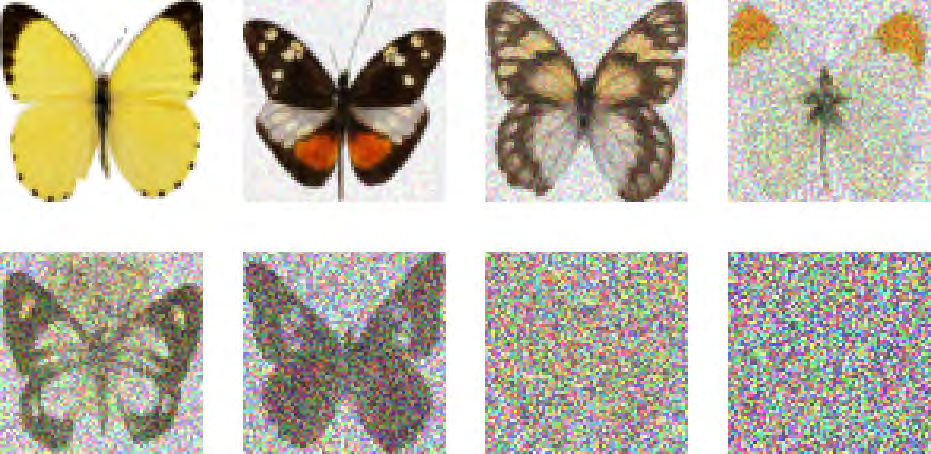
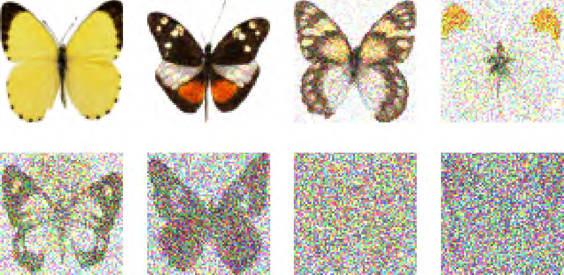
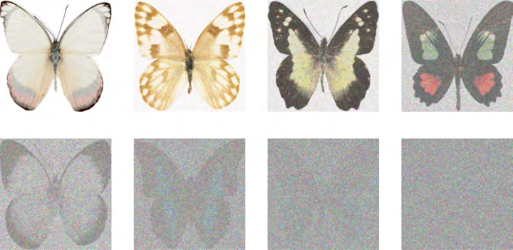
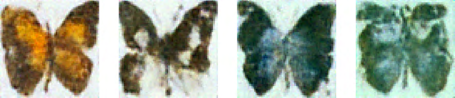

# REVIEW_1 ? OCR-negative (LIVE decisions), largest first

### xref 926 ? page 297 ? 1024x512 ? 1,171,895 -> 130,085 bytes as q90 JPEG

**OCR: no text detected** ? decision is LIVE: review for thin lines, fine detail, ringing risk; flag this xref if JPEG would damage anything

### xref 467 ? page 148 ? 931x454 ? 972,598 -> 233,017 bytes as q90 JPEG

**OCR: no text detected** ? decision is LIVE: review for thin lines, fine detail, ringing risk; flag this xref if JPEG would damage anything

### xref 470 ? page 149 ? 931x454 ? 972,305 -> 233,118 bytes as q90 JPEG

**OCR: no text detected** ? decision is LIVE: review for thin lines, fine detail, ringing risk; flag this xref if JPEG would damage anything

### xref 473 ? page 150 ? 931x454 ? 922,798 -> 260,076 bytes as q90 JPEG

**OCR: no text detected** ? decision is LIVE: review for thin lines, fine detail, ringing risk; flag this xref if JPEG would damage anything

### xref 956 ? page 305 ? 720x360 ? 663,252 -> 86,079 bytes as q90 JPEG

**OCR: no text detected** ? decision is LIVE: review for thin lines, fine detail, ringing risk; flag this xref if JPEG would damage anything

### xref 834 ? page 267 ? 512x512 ? 650,176 -> 67,172 bytes as q90 JPEG

**OCR: no text detected** ? decision is LIVE: review for thin lines, fine detail, ringing risk; flag this xref if JPEG would damage anything

### xref 87 ? page 26 ? 512x512 ? 620,644 -> 75,141 bytes as q90 JPEG

**OCR: no text detected** ? decision is LIVE: review for thin lines, fine detail, ringing risk; flag this xref if JPEG would damage anything

### xref 934 ? page 299 ? 720x360 ? 524,836 -> 85,876 bytes as q90 JPEG

**OCR: no text detected** ? decision is LIVE: review for thin lines, fine detail, ringing risk; flag this xref if JPEG would damage anything

### xref 575 ? page 181 ? 512x512 ? 504,866 -> 68,712 bytes as q90 JPEG

**OCR: no text detected** ? decision is LIVE: review for thin lines, fine detail, ringing risk; flag this xref if JPEG would damage anything

### xref 436 ? page 139 ? 720x351 ? 500,551 -> 96,319 bytes as q90 JPEG

**OCR: no text detected** ? decision is LIVE: review for thin lines, fine detail, ringing risk; flag this xref if JPEG would damage anything

### xref 452 ? page 144 ? 931x202 ? 486,959 -> 69,869 bytes as q90 JPEG

**OCR: no text detected** ? decision is LIVE: review for thin lines, fine detail, ringing risk; flag this xref if JPEG would damage anything

### xref 448 ? page 143 ? 931x202 ? 464,215 -> 62,360 bytes as q90 JPEG

**OCR: no text detected** ? decision is LIVE: review for thin lines, fine detail, ringing risk; flag this xref if JPEG would damage anything

### xref 631 ? page 197 ? 496x331 ? 453,184 -> 84,056 bytes as q90 JPEG

**OCR: no text detected** ? decision is LIVE: review for thin lines, fine detail, ringing risk; flag this xref if JPEG would damage anything

### xref 913 ? page 293 ? 512x512 ? 443,807 -> 64,036 bytes as q90 JPEG

**OCR: no text detected** ? decision is LIVE: review for thin lines, fine detail, ringing risk; flag this xref if JPEG would damage anything

### xref 910 ? page 292 ? 512x512 ? 440,653 -> 63,102 bytes as q90 JPEG

**OCR: no text detected** ? decision is LIVE: review for thin lines, fine detail, ringing risk; flag this xref if JPEG would damage anything

### xref 907 ? page 291 ? 512x512 ? 437,141 -> 63,498 bytes as q90 JPEG

**OCR: no text detected** ? decision is LIVE: review for thin lines, fine detail, ringing risk; flag this xref if JPEG would damage anything

### xref 432 ? page 138 ? 720x351 ? 424,440 -> 71,034 bytes as q90 JPEG

**OCR: no text detected** ? decision is LIVE: review for thin lines, fine detail, ringing risk; flag this xref if JPEG would damage anything

### xref 367 ? page 116 ? 600x400 ? 422,294 -> 58,309 bytes as q90 JPEG

**OCR: no text detected** ? decision is LIVE: review for thin lines, fine detail, ringing risk; flag this xref if JPEG would damage anything

