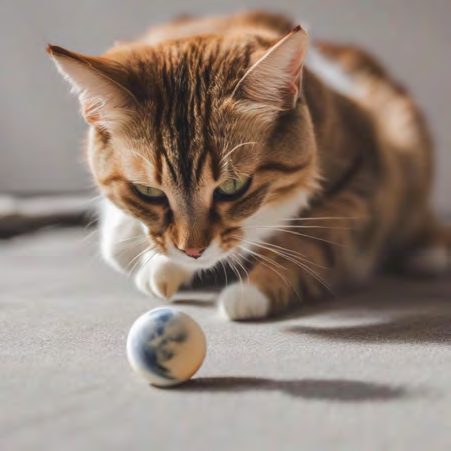
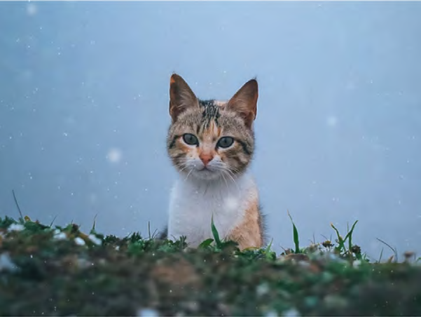
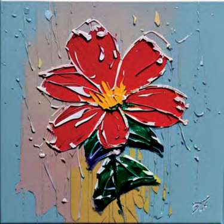
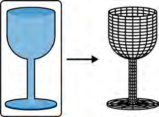

# REVIEW 2 ? OCR-negative images, Image 019?036 (verdicts closed)

## Image 019 ? xref 903

- Pages: 290
- Dimensions: 720x240
- Size as lossless PNG: 405,187 bytes ? as JPEG q90: 57,726 bytes
- OCR: **OCR NEGATIVE** ? no text detected. OCR-negative is not proof of JPEG safety: review for thin strokes, high-contrast edges, small geometric features, repeating patterns, ringing risk
- Full resolution: [Open image](full_p290_x903.png)

- **Review verdict: JPEG-ELIGIBLE**
- Reason: Mixed photographic/realistic collage; no obvious material degradation at the reviewed scale.
- Reviewed: 2026-10-14 (reviewer verdict; Images 001-036 closed)

## Image 020 ? xref 611

- Pages: 191
- Dimensions: 451x451
- Size as lossless PNG: 385,953 bytes ? as JPEG q90: 44,363 bytes
- OCR: **OCR NEGATIVE** ? no text detected. OCR-negative is not proof of JPEG safety: review for thin strokes, high-contrast edges, small geometric features, repeating patterns, ringing risk
- Full resolution: [Open image](full_p191_x611.png)

- **Review verdict: JPEG-ELIGIBLE**
- Reason: Cat photograph; no obvious material degradation.
- Reviewed: 2026-10-14 (reviewer verdict; Images 001-036 closed)

## Image 021 ? xref 373

- Pages: 118
- Dimensions: 450x451
- Size as lossless PNG: 384,255 bytes ? as JPEG q90: 57,522 bytes
- OCR: **OCR NEGATIVE** ? no text detected. OCR-negative is not proof of JPEG safety: review for thin strokes, high-contrast edges, small geometric features, repeating patterns, ringing risk
- Full resolution: [Open image](full_p118_x373.png)

- **Review verdict: JPEG-ELIGIBLE**
- Reason: Wildlife photograph; no obvious material degradation.
- Reviewed: 2026-10-14 (reviewer verdict; Images 001-036 closed)

## Image 022 ? xref 218

- Pages: 68
- Dimensions: 601x452
- Size as lossless PNG: 352,753 bytes ? as JPEG q90: 42,784 bytes
- OCR: **OCR NEGATIVE** ? no text detected. OCR-negative is not proof of JPEG safety: review for thin strokes, high-contrast edges, small geometric features, repeating patterns, ringing risk
- Full resolution: [Open image](full_p068_x218.png)

- **Review verdict: JPEG-ELIGIBLE**
- Reason: Cat photograph; no obvious material degradation.
- Reviewed: 2026-10-14 (reviewer verdict; Images 001-036 closed)

## Image 023 ? xref 618

- Pages: 193
- Dimensions: 720x180
- Size as lossless PNG: 346,518 bytes ? as JPEG q90: 49,238 bytes
- OCR: **OCR NEGATIVE** ? no text detected. OCR-negative is not proof of JPEG safety: review for thin strokes, high-contrast edges, small geometric features, repeating patterns, ringing risk
- Full resolution: [Open image](full_p193_x618.png)

- **Review verdict: JPEG-ELIGIBLE**
- Reason: Photographic strip; no obvious material degradation at the reviewed scale.
- Reviewed: 2026-10-14 (reviewer verdict; Images 001-036 closed)

## Image 024 ? xref 625

- Pages: 195
- Dimensions: 375x375
- Size as lossless PNG: 307,926 bytes ? as JPEG q90: 52,870 bytes
- OCR: **OCR NEGATIVE** ? no text detected. OCR-negative is not proof of JPEG safety: review for thin strokes, high-contrast edges, small geometric features, repeating patterns, ringing risk
- Full resolution: [Open image](full_p195_x625.png)

- **Review verdict: LOSSLESS**
- Reason: Stylized flower painting with strong outlines and texture.
- Reviewed: 2026-10-14 (reviewer verdict; Images 001-036 closed)

## Image 025 ? xref 965

- Pages: 308
- Dimensions: 721x181
- Size as lossless PNG: 297,760 bytes ? as JPEG q90: 48,505 bytes
- OCR: **OCR NEGATIVE** ? no text detected. OCR-negative is not proof of JPEG safety: review for thin strokes, high-contrast edges, small geometric features, repeating patterns, ringing risk
- Full resolution: [Open image](full_p308_x965.png)

- **Review verdict: LOSSLESS**
- Reason: Mixed photographic, illustrated, and silhouette panels.
- Reviewed: 2026-10-14 (reviewer verdict; Images 001-036 closed)

## Image 026 ? xref 892

- Pages: 286
- Dimensions: 720x240
- Size as lossless PNG: 289,946 bytes ? as JPEG q90: 46,095 bytes
- OCR: **OCR NEGATIVE** ? no text detected. OCR-negative is not proof of JPEG safety: review for thin strokes, high-contrast edges, small geometric features, repeating patterns, ringing risk
- Full resolution: [Open image](full_p286_x892.png)

- **Review verdict: LOSSLESS**
- Reason: Photographs combined with a high-contrast silhouette mask.
- Reviewed: 2026-10-14 (reviewer verdict; Images 001-036 closed)

## Image 027 ? xref 412

- Pages: 132
- Dimensions: 720x135
- Size as lossless PNG: 281,861 bytes ? as JPEG q90: 85,430 bytes
- OCR: **OCR NEGATIVE** ? no text detected. OCR-negative is not proof of JPEG safety: review for thin strokes, high-contrast edges, small geometric features, repeating patterns, ringing risk
- Full resolution: [Open image](full_p132_x412.png)

- **Review verdict: LOSSLESS**
- Reason: Preserve the noise-pattern sequence and small embedded imagery.
- Reviewed: 2026-10-14 (reviewer verdict; Images 001-036 closed)

## Image 028 ? xref 848

- Pages: 272
- Dimensions: 720x144
- Size as lossless PNG: 281,784 bytes ? as JPEG q90: 44,970 bytes
- OCR: **OCR NEGATIVE** ? no text detected. OCR-negative is not proof of JPEG safety: review for thin strokes, high-contrast edges, small geometric features, repeating patterns, ringing risk
- Full resolution: [Open image](full_p272_x848.png)

- **Review verdict: JPEG-ELIGIBLE**
- Reason: Portrait strip; no obvious material degradation.
- Reviewed: 2026-10-14 (reviewer verdict; Images 001-036 closed)

## Image 029 ? xref 598

- Pages: 187
- Dimensions: 370x370
- Size as lossless PNG: 269,502 bytes ? as JPEG q90: 32,035 bytes
- OCR: **OCR NEGATIVE** ? no text detected. OCR-negative is not proof of JPEG safety: review for thin strokes, high-contrast edges, small geometric features, repeating patterns, ringing risk
- Full resolution: [Open image](full_p187_x598.png)

- **Review verdict: JPEG-ELIGIBLE**
- Reason: Wildlife photograph; no obvious material degradation.
- Reviewed: 2026-10-14 (reviewer verdict; Images 001-036 closed)

## Image 030 ? xref 590

- Pages: 185
- Dimensions: 370x370
- Size as lossless PNG: 264,507 bytes ? as JPEG q90: 31,411 bytes
- OCR: **OCR NEGATIVE** ? no text detected. OCR-negative is not proof of JPEG safety: review for thin strokes, high-contrast edges, small geometric features, repeating patterns, ringing risk
- Full resolution: [Open image](full_p185_x590.png)

- **Review verdict: JPEG-ELIGIBLE**
- Reason: Wildlife photograph; no obvious material degradation.
- Reviewed: 2026-10-14 (reviewer verdict; Images 001-036 closed)

## Image 031 ? xref 945

- Pages: 302
- Dimensions: 720x240
- Size as lossless PNG: 239,475 bytes ? as JPEG q90: 32,198 bytes
- OCR: **OCR NEGATIVE** ? no text detected. OCR-negative is not proof of JPEG safety: review for thin strokes, high-contrast edges, small geometric features, repeating patterns, ringing risk
- Full resolution: [Open image](full_p302_x945.png)

- **Review verdict: LOSSLESS**
- Reason: Mixed photographic and silhouette content.
- Reviewed: 2026-10-14 (reviewer verdict; Images 001-036 closed)

## Image 032 ? xref 860

- Pages: 275
- Dimensions: 451x451
- Size as lossless PNG: 220,071 bytes ? as JPEG q90: 43,851 bytes
- OCR: **OCR NEGATIVE** ? no text detected. OCR-negative is not proof of JPEG safety: review for thin strokes, high-contrast edges, small geometric features, repeating patterns, ringing risk
- Full resolution: [Open image](full_p275_x860.png)

- **Review verdict: LOSSLESS**
- Reason: Flat-color illustration with crisp boundaries.
- Reviewed: 2026-10-14 (reviewer verdict; Images 001-036 closed)

## Image 033 ? xref 416

- Pages: 133
- Dimensions: 256x256
- Size as lossless PNG: 154,716 bytes ? as JPEG q90: 15,803 bytes
- OCR: **OCR NEGATIVE** ? no text detected. OCR-negative is not proof of JPEG safety: review for thin strokes, high-contrast edges, small geometric features, repeating patterns, ringing risk
- Full resolution: [Open image](full_p133_x416.png)

- **Review verdict: JPEG-ELIGIBLE**
- Reason: Portrait photograph; no obvious material degradation.
- Reviewed: 2026-10-14 (reviewer verdict; Images 001-036 closed)

## Image 034 ? xref 1196

- Pages: 383
- Dimensions: 311x230
- Size as lossless PNG: 83,988 bytes ? as JPEG q90: 20,486 bytes
- OCR: **OCR NEGATIVE** ? no text detected. OCR-negative is not proof of JPEG safety: review for thin strokes, high-contrast edges, small geometric features, repeating patterns, ringing risk
- Full resolution: [Open image](full_p383_x1196.png)

- **Review verdict: LOSSLESS**
- Reason: Diagram with thin outlines and geometric detail.
- Reviewed: 2026-10-14 (reviewer verdict; Images 001-036 closed)

## Image 035 ? xref 1339

- Pages: 16, 90
- Dimensions: 87x117
- Size as lossless PNG: 17,535 bytes ? as JPEG q90: 5,176 bytes
- OCR: **OCR NEGATIVE** ? no text detected. OCR-negative is not proof of JPEG safety: review for thin strokes, high-contrast edges, small geometric features, repeating patterns, ringing risk
- Full resolution: [Open image](full_p016_x1339.png)

- **Review verdict: LOSSLESS**
- Reason: Small, sharply defined green illustration.
- Reviewed: 2026-10-14 (reviewer verdict; Images 001-036 closed)

## Image 036 ? xref 1338

- Pages: 16, 37, 38, 39, 52, 73, 81, 103, 154, 165, 173, 181, 197, 207, 211, 215, 251, 254, 270, 317, 325, 326, 329, 331, 332, 335, 340, 343, 354, 355, 357
- Dimensions: 80x104
- Size as lossless PNG: 15,756 bytes ? as JPEG q90: 4,155 bytes
- OCR: **OCR NEGATIVE** ? no text detected. OCR-negative is not proof of JPEG safety: review for thin strokes, high-contrast edges, small geometric features, repeating patterns, ringing risk
- Full resolution: [Open image](full_p016_x1338.png)

- **Review verdict: LOSSLESS**
- Reason: Small, sharply defined bird illustration.
- Reviewed: 2026-10-14 (reviewer verdict; Images 001-036 closed)
