# REVIEW 3 ? OCR-positive images, Image 037?064 (all verdicts recorded)

## Image 037 ? xref 1156

- Pages: 371
- Dimensions: 720x757
- Size as lossless PNG: 1,321,349 bytes ? as JPEG q90: 205,177 bytes
- OCR: **TEXT DETECTED** ? 2 item(s): 'Before RLHFfine-tuning' (h27px); 'After RLHFfine-tuning' (h28px)
- Policy default: **UNCERTAIN ? lossless PNG** (OCR-positive); any reconsideration requires recorded rationale under a revised policy, never a silent override
- Full resolution: [Open image](full_p371_x1156.png)

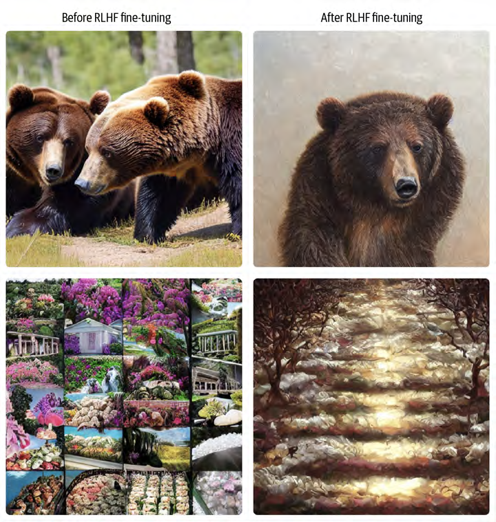

- **Review verdict: LOSSLESS**
- Reason: Mixed collage of animal photographs, a market scene, and a textured image; multiple content types.
- Reviewed: 2026-10-14 (reviewer screening verdict from inspection of the 104 source images)

## Image 038 ? xref 930

- Pages: 298
- Dimensions: 720x616
- Size as lossless PNG: 853,956 bytes ? as JPEG q90: 123,657 bytes
- OCR: **TEXT DETECTED** ? 6 item(s): 'Inputimage' (h25px); '"addclownfacepaint"' (h21px); '"turnherintoabeardedman”' (h19px); '"giveherabigsmile"' (h24px)
- Policy default: **UNCERTAIN ? lossless PNG** (OCR-positive); any reconsideration requires recorded rationale under a revised policy, never a silent override
- Full resolution: [Open image](full_p298_x930.png)

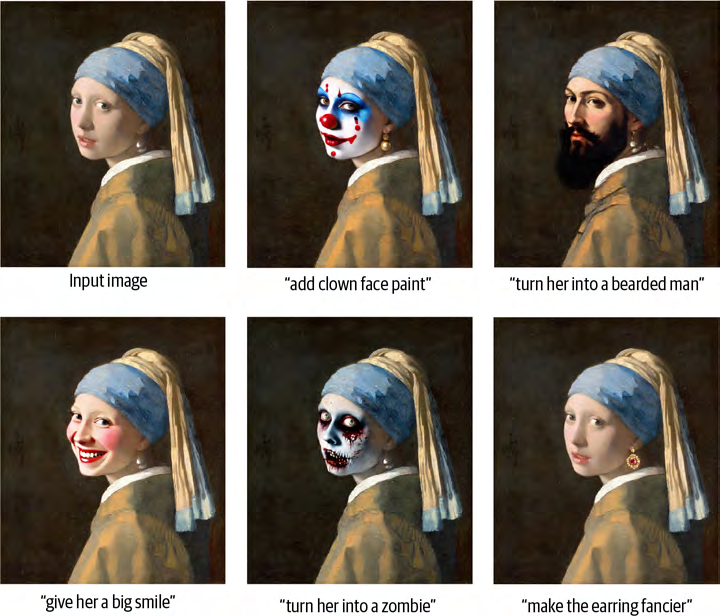

- **Review verdict: LOSSLESS**
- Reason: Stylized portrait variations and artistic transformations, not a straightforward photographic source.
- Reviewed: 2026-10-14 (reviewer screening verdict from inspection of the 104 source images)

## Image 039 ? xref 419

- Pages: 134
- Dimensions: 721x488
- Size as lossless PNG: 800,162 bytes ? as JPEG q90: 150,609 bytes
- OCR: **TEXT DETECTED** ? 8 item(s): 'Currentx(stepO)' (h20px); 'Predicteddenoisedimages(step0)' (h19px); 'Currentx(step10)' (h18px); 'Predicted denoised images(step10)' (h21px)
- Policy default: **UNCERTAIN ? lossless PNG** (OCR-positive); any reconsideration requires recorded rationale under a revised policy, never a silent override
- Full resolution: [Open image](full_p134_x419.png)

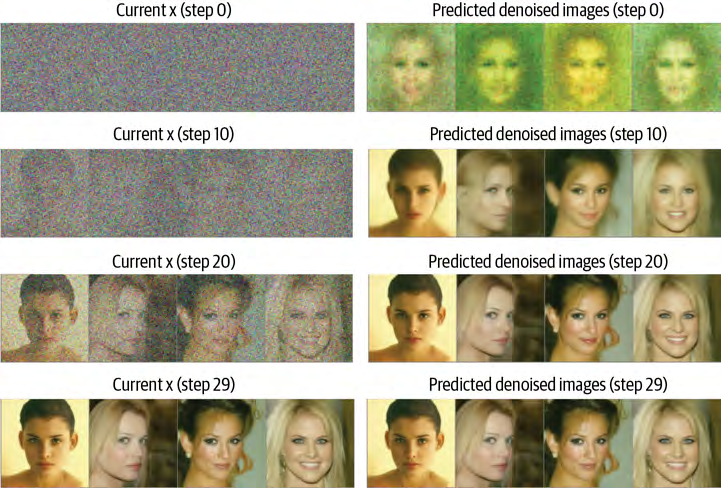

- **Review verdict: LOSSLESS**
- Reason: Denoising experiment grid combining noisy inputs, generated face outputs, and step labels.
- Reviewed: 2026-10-14 (reviewer screening verdict from inspection of the 104 source images)

## Image 040 ? xref 602

- Pages: 188
- Dimensions: 721x845
- Size as lossless PNG: 736,791 bytes ? as JPEG q90: 168,778 bytes
- OCR: **TEXT DETECTED** ? 34 item(s): 'Prompt' (h24px); 'Timestept' (h23px); 'Noisyx' (h27px); 'CrossAttnDown' (h23px)
- Policy default: **UNCERTAIN ? lossless PNG** (OCR-positive); any reconsideration requires recorded rationale under a revised policy, never a silent override
- Full resolution: [Open image](full_p188_x602.png)

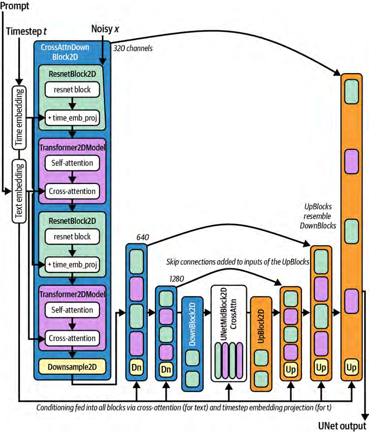

- **Review verdict: LOSSLESS**
- Reason: Neural-network architecture diagram with small labels, connectors, and colored blocks.
- Reviewed: 2026-10-14 (reviewer screening verdict from inspection of the 104 source images)

## Image 041 ? xref 962

- Pages: 307
- Dimensions: 720x360
- Size as lossless PNG: 720,632 bytes ? as JPEG q90: 102,939 bytes
- OCR: **TEXT DETECTED** ? 1 item(s): 'M米米' (h67px)
- Policy default: **UNCERTAIN ? lossless PNG** (OCR-positive); any reconsideration requires recorded rationale under a revised policy, never a silent override
- Full resolution: [Open image](full_p307_x962.png)

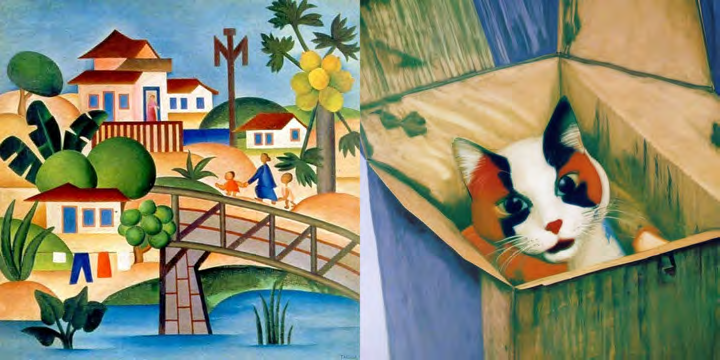

- **Review verdict: LOSSLESS**
- Reason: Collage of painted or illustrated scenes; fine brush-like texture and artwork edges should be preserved.
- Reviewed: 2026-10-14 (reviewer screening verdict from inspection of the 104 source images)

## Image 042 ? xref 463

- Pages: 147
- Dimensions: 721x415
- Size as lossless PNG: 719,227 bytes ? as JPEG q90: 124,838 bytes
- OCR: **TEXT DETECTED** ? 9 item(s): 'Forward' (h17px); 'Reverse' (h20px); 'Original' (h20px); 'Degraded' (h21px)
- Policy default: **UNCERTAIN ? lossless PNG** (OCR-positive); any reconsideration requires recorded rationale under a revised policy, never a silent override
- Full resolution: [Open image](full_p147_x463.png)

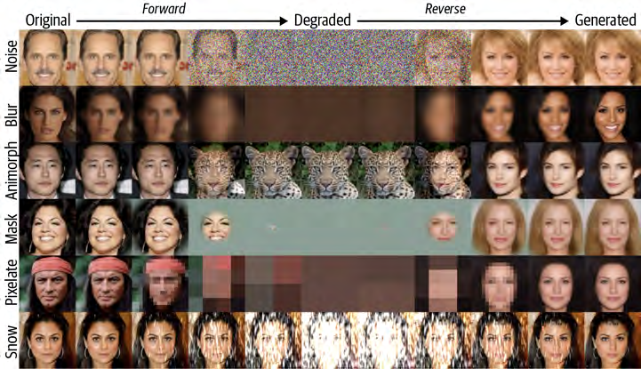

- **Review verdict: LOSSLESS**
- Reason: Face-image processing comparison grid with labeled stages and degradation examples.
- Reviewed: 2026-10-14 (reviewer screening verdict from inspection of the 104 source images)

## Image 043 ? xref 513

- Pages: 162
- Dimensions: 708x792
- Size as lossless PNG: 687,390 bytes ? as JPEG q90: 154,955 bytes
- OCR: **TEXT DETECTED** ? 47 item(s): 'UNet' (h23px); 'Embedinput' (h98px); 'Project output' (h108px); 'ResBlock' (h68px)
- Policy default: **UNCERTAIN ? lossless PNG** (OCR-positive); any reconsideration requires recorded rationale under a revised policy, never a silent override
- Full resolution: [Open image](full_p162_x513.png)

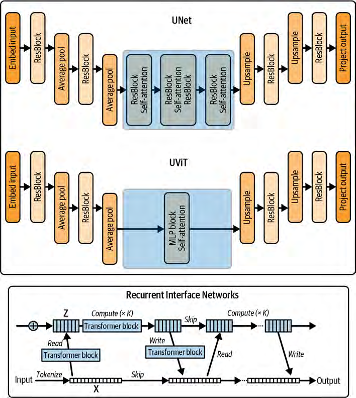

- **Review verdict: LOSSLESS**
- Reason: UNet and related architecture diagrams with fine connectors and embedded labels.
- Reviewed: 2026-10-14 (reviewer screening verdict from inspection of the 104 source images)

## Image 044 ? xref 193

- Pages: 60
- Dimensions: 714x811
- Size as lossless PNG: 641,765 bytes ? as JPEG q90: 176,711 bytes
- OCR: **TEXT DETECTED** ? 54 item(s): 'DeepSeek2.5' (h22px); 'Llama3.2' (h19px); 'OLMoE' (h18px); 'SmoLM' (h25px)
- Policy default: **UNCERTAIN ? lossless PNG** (OCR-positive); any reconsideration requires recorded rationale under a revised policy, never a silent override
- Full resolution: [Open image](full_p060_x193.png)

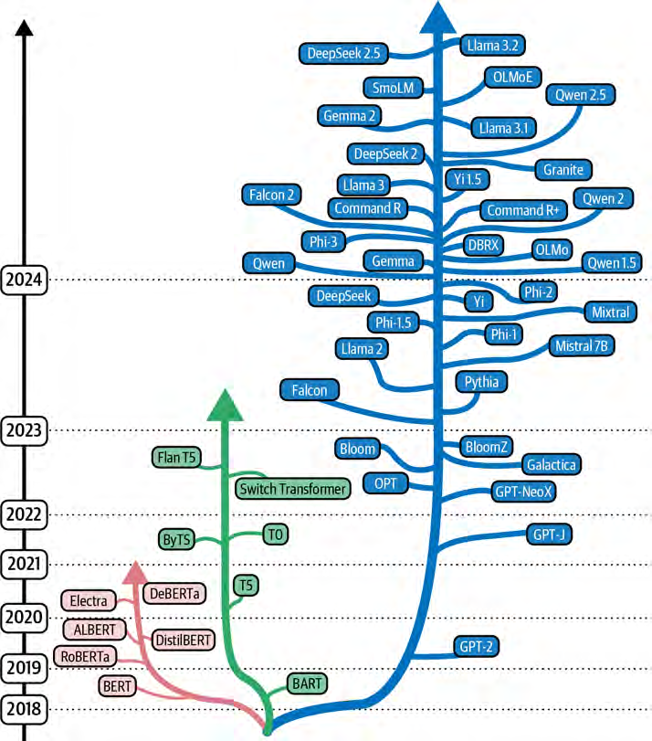

- **Review verdict: LOSSLESS**
- Reason: Dense model-family/tree diagram with small text, colored nodes, and connecting lines.
- Reviewed: 2026-10-14 (reviewer screening verdict from inspection of the 104 source images)

## Image 045 ? xref 520

- Pages: 164
- Dimensions: 721x494
- Size as lossless PNG: 621,308 bytes ? as JPEG q90: 119,856 bytes
- OCR: **TEXT DETECTED** ? 12 item(s): 'Inputimage' (h18px); 'Inputimage' (h18px); 'Inputimage' (h18px); 'Input image' (h18px)
- Policy default: **UNCERTAIN ? lossless PNG** (OCR-positive); any reconsideration requires recorded rationale under a revised policy, never a silent override
- Full resolution: [Open image](full_p164_x520.png)

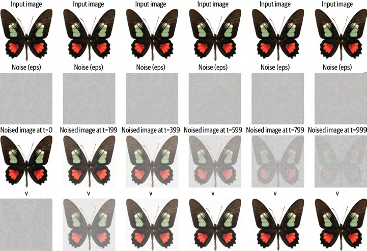

- **Review verdict: LOSSLESS**
- Reason: Repeated butterfly examples paired with segmentation or mask outputs and labels.
- Reviewed: 2026-10-14 (reviewer screening verdict from inspection of the 104 source images)

## Image 046 ? xref 1188

- Pages: 381
- Dimensions: 676x449
- Size as lossless PNG: 544,759 bytes ? as JPEG q90: 77,025 bytes
- OCR: **TEXT DETECTED** ? 4 item(s): 'person0.93' (h21px); 'boat0.69' (h22px); 'perso' (h19px); 'boat0.351' (h23px)
- Policy default: **UNCERTAIN ? lossless PNG** (OCR-positive); any reconsideration requires recorded rationale under a revised policy, never a silent override
- Full resolution: [Open image](full_p381_x1188.png)

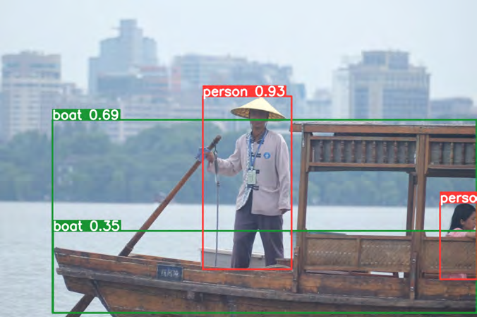

- **Review verdict: LOSSLESS**
- Reason: Object-detection image with bounding boxes, confidence labels, and fine overlay text.
- Reviewed: 2026-10-14 (reviewer screening verdict from inspection of the 104 source images)

## Image 047 ? xref 788

- Pages: 252
- Dimensions: 1049x623
- Size as lossless PNG: 534,738 bytes ? as JPEG q90: 168,360 bytes
- OCR: **TEXT DETECTED** ? 88 item(s): 'Arena' (h18px); 'NEW:Arena (Vision)' (h21px); 'Arena-Hard-Auto' (h17px); 'Full Leaderboard' (h17px)
- Policy default: **UNCERTAIN ? lossless PNG** (OCR-positive); any reconsideration requires recorded rationale under a revised policy, never a silent override
- Full resolution: [Open image](full_p252_x788.png)

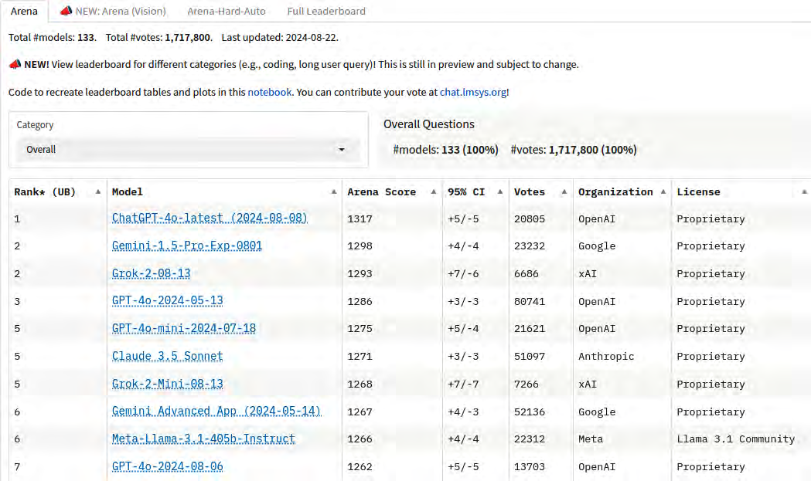

- **Review verdict: LOSSLESS**
- Reason: Leaderboard/table screenshot containing dense text and small numerical entries.
- Reviewed: 2026-10-14 (reviewer screening verdict from inspection of the 104 source images)

## Image 048 ? xref 888

- Pages: 285
- Dimensions: 720x345
- Size as lossless PNG: 524,462 bytes ? as JPEG q90: 73,333 bytes
- OCR: **TEXT DETECTED** ? 10 item(s): '0.1' (h20px); '0.2' (h20px); '0.3' (h19px); '0.4' (h21px)
- Policy default: **UNCERTAIN ? lossless PNG** (OCR-positive); any reconsideration requires recorded rationale under a revised policy, never a silent override
- Full resolution: [Open image](full_p285_x888.png)

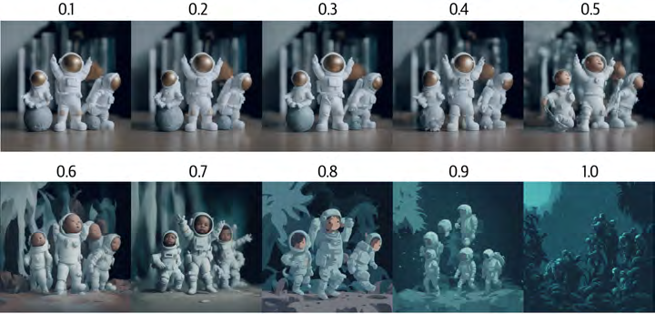

- **Review verdict: JPEG-ELIGIBLE**
- Reason: Photographic astronaut sequence; no material loss of visible numeric labels or meaningful detail at q90. Documented, reviewer-approved reconsideration of the OCR-positive default.
- Reviewed: 2026-10-14 (reviewer screening verdict from inspection of the 104 source images)

## Image 049 ? xref 243

- Pages: 76
- Dimensions: 712x461
- Size as lossless PNG: 502,192 bytes ? as JPEG q90: 93,954 bytes
- OCR: **TEXT DETECTED** ? 17 item(s): 'Obtainrepresentations' (h19px); 'usinga differentmethod' (h19px); 'Encoder' (h20px); 'Encoder' (h20px)
- Policy default: **UNCERTAIN ? lossless PNG** (OCR-positive); any reconsideration requires recorded rationale under a revised policy, never a silent override
- Full resolution: [Open image](full_p076_x243.png)

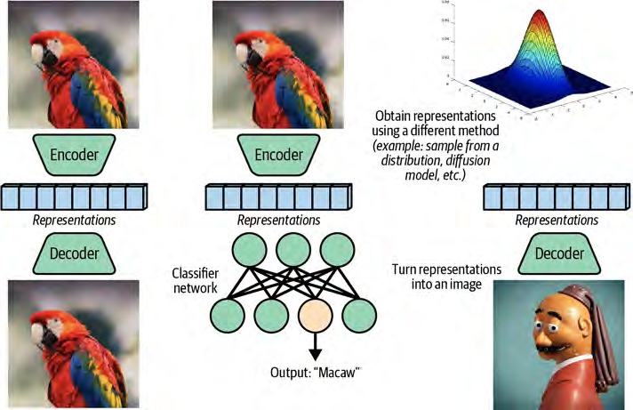

- **Review verdict: LOSSLESS**
- Reason: Bird photographs embedded within an encoder/decoder and representation-learning diagram.
- Reviewed: 2026-10-14 (reviewer screening verdict from inspection of the 104 source images)

## Image 050 ? xref 342

- Pages: 109
- Dimensions: 721x575
- Size as lossless PNG: 498,704 bytes ? as JPEG q90: 145,803 bytes
- OCR: **TEXT DETECTED** ? 14 item(s): '3' (h14px); '2' (h10px); '2' (h11px); '0' (h13px)
- Policy default: **UNCERTAIN ? lossless PNG** (OCR-positive); any reconsideration requires recorded rationale under a revised policy, never a silent override
- Full resolution: [Open image](full_p109_x342.png)

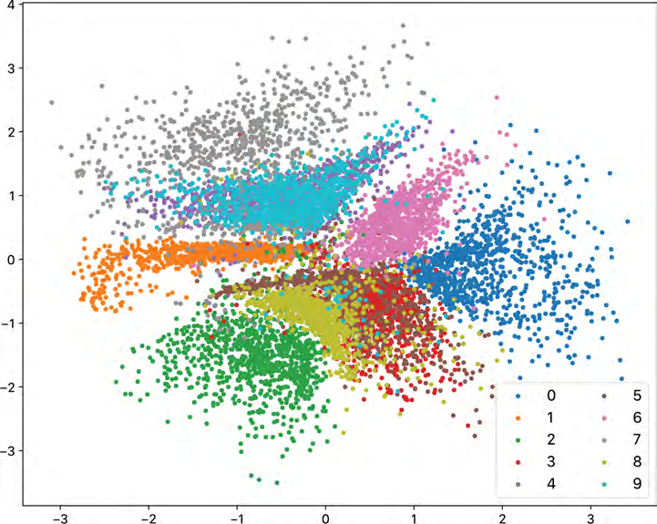

- **Review verdict: LOSSLESS**
- Reason: Multicolored scatter plot; small points and plot details are meaningful.
- Reviewed: 2026-10-14 (reviewer screening verdict from inspection of the 104 source images)

## Image 051 ? xref 302

- Pages: 96
- Dimensions: 721x572
- Size as lossless PNG: 494,323 bytes ? as JPEG q90: 152,908 bytes
- OCR: **TEXT DETECTED** ? 14 item(s): '0' (h15px); '6' (h16px); '1' (h12px); '7' (h17px)
- Policy default: **UNCERTAIN ? lossless PNG** (OCR-positive); any reconsideration requires recorded rationale under a revised policy, never a silent override
- Full resolution: [Open image](full_p096_x302.png)

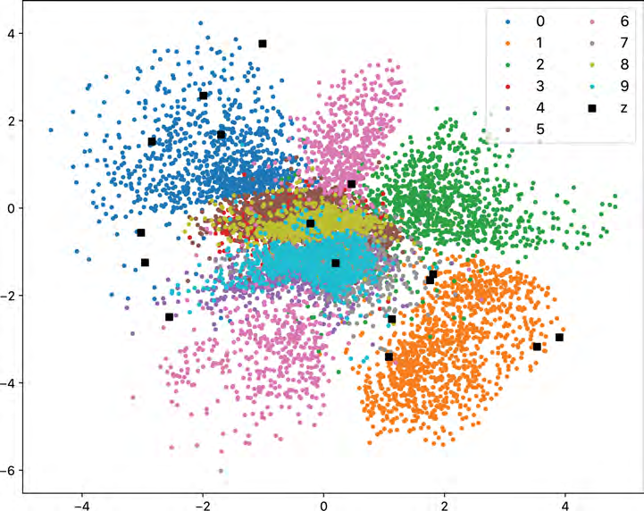

- **Review verdict: LOSSLESS**
- Reason: Multicolored scatter plot with dense point clusters and legend.
- Reviewed: 2026-10-14 (reviewer screening verdict from inspection of the 104 source images)

## Image 052 ? xref 937

- Pages: 300
- Dimensions: 601x458
- Size as lossless PNG: 493,460 bytes ? as JPEG q90: 94,964 bytes
- OCR: **TEXT DETECTED** ? 8 item(s): 'Imageinput' (h23px); 'Inputcannyedges' (h22px); 'Output:' (h21px); '"acapybaraonthesnow”' (h20px)
- Policy default: **UNCERTAIN ? lossless PNG** (OCR-positive); any reconsideration requires recorded rationale under a revised policy, never a silent override
- Full resolution: [Open image](full_p300_x937.png)

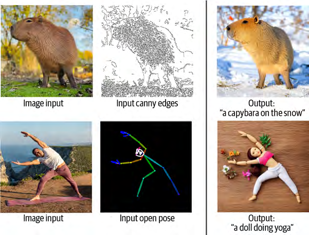

- **Review verdict: LOSSLESS**
- Reason: Mixed animal and human photographs, edge maps, and generated outputs with captions.
- Reviewed: 2026-10-14 (reviewer screening verdict from inspection of the 104 source images)

## Image 053 ? xref 299

- Pages: 95
- Dimensions: 721x572
- Size as lossless PNG: 492,070 bytes ? as JPEG q90: 151,975 bytes
- OCR: **TEXT DETECTED** ? 12 item(s): '0' (h15px); '5' (h18px); '1' (h13px); '6' (h19px)
- Policy default: **UNCERTAIN ? lossless PNG** (OCR-positive); any reconsideration requires recorded rationale under a revised policy, never a silent override
- Full resolution: [Open image](full_p095_x299.png)

- **Review verdict: LOSSLESS**
- Reason: Multicolored scatter plot with fine individual points and clusters.
- Reviewed: 2026-10-14 (reviewer screening verdict from inspection of the 104 source images)

## Image 054 ? xref 1028

- Pages: 327
- Dimensions: 556x413
- Size as lossless PNG: 477,985 bytes ? as JPEG q90: 79,794 bytes
- OCR: **TEXT DETECTED** ? 25 item(s): '+0dB' (h11px); '-10dB' (h17px); '4096' (h16px); '-20dB' (h15px)
- Policy default: **UNCERTAIN ? lossless PNG** (OCR-positive); any reconsideration requires recorded rationale under a revised policy, never a silent override
- Full resolution: [Open image](full_p327_x1028.png)

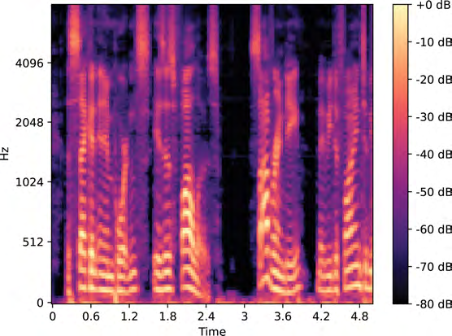

- **Review verdict: LOSSLESS**
- Reason: Audio spectrogram with frequency/time axes and a calibrated color scale.
- Reviewed: 2026-10-14 (reviewer screening verdict from inspection of the 104 source images)

## Image 055 ? xref 1114

- Pages: 357
- Dimensions: 556x413
- Size as lossless PNG: 473,601 bytes ? as JPEG q90: 81,460 bytes
- OCR: **TEXT DETECTED** ? 26 item(s): '+0dB' (h11px); '8192' (h16px); '-10dB' (h13px); '4096' (h16px)
- Policy default: **UNCERTAIN ? lossless PNG** (OCR-positive); any reconsideration requires recorded rationale under a revised policy, never a silent override
- Full resolution: [Open image](full_p357_x1114.png)

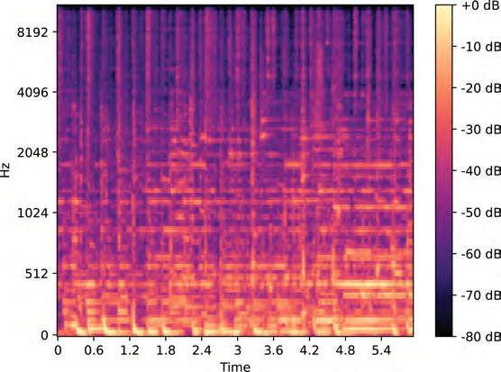

- **Review verdict: LOSSLESS**
- Reason: Audio spectrogram with dense frequency detail and small axis labels.
- Reviewed: 2026-10-14 (reviewer screening verdict from inspection of the 104 source images)

## Image 056 ? xref 346

- Pages: 110
- Dimensions: 721x573
- Size as lossless PNG: 472,828 bytes ? as JPEG q90: 138,108 bytes
- OCR: **TEXT DETECTED** ? 14 item(s): '4' (h10px); '3' (h12px); '2' (h9px); '2' (h9px)
- Policy default: **UNCERTAIN ? lossless PNG** (OCR-positive); any reconsideration requires recorded rationale under a revised policy, never a silent override
- Full resolution: [Open image](full_p110_x346.png)

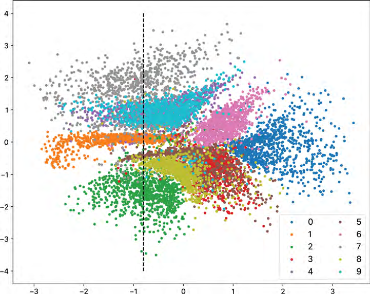

- **Review verdict: LOSSLESS**
- Reason: Scatter plot with fine points and a legend.
- Reviewed: 2026-10-14 (reviewer screening verdict from inspection of the 104 source images)

## Image 057 ? xref 1023

- Pages: 325
- Dimensions: 556x413
- Size as lossless PNG: 468,010 bytes ? as JPEG q90: 91,985 bytes
- OCR: **TEXT DETECTED** ? 27 item(s): '8000' (h15px); '+0dB' (h11px); '7000' (h16px); '-10dB' (h15px)
- Policy default: **UNCERTAIN ? lossless PNG** (OCR-positive); any reconsideration requires recorded rationale under a revised policy, never a silent override
- Full resolution: [Open image](full_p325_x1023.png)

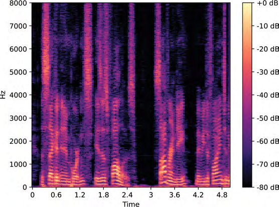

- **Review verdict: LOSSLESS**
- Reason: Spectrogram with thin frequency structures and a labeled scale.
- Reviewed: 2026-10-14 (reviewer screening verdict from inspection of the 104 source images)

## Image 058 ? xref 735

- Pages: 234
- Dimensions: 716x414
- Size as lossless PNG: 464,864 bytes ? as JPEG q90: 122,621 bytes
- OCR: **TEXT DETECTED** ? 25 item(s): 'Instructionfine-tuning' (h23px); 'Pleaseanswerthefollowingquestion:' (h22px); 'Whatistheboilingpointofnitrogen?' (h20px); '-320.4°F' (h19px)
- Policy default: **UNCERTAIN ? lossless PNG** (OCR-positive); any reconsideration requires recorded rationale under a revised policy, never a silent override
- Full resolution: [Open image](full_p234_x735.png)

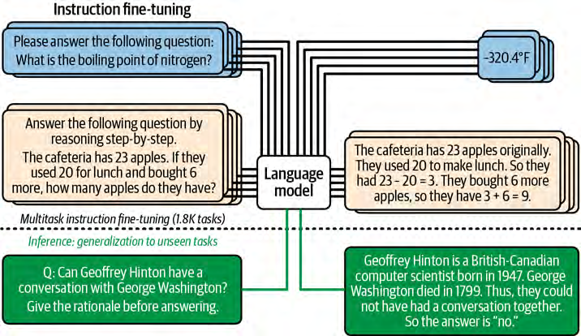

- **Review verdict: LOSSLESS**
- Reason: Instruction-following flowchart with multiple text boxes, connectors, and small text.
- Reviewed: 2026-10-14 (reviewer screening verdict from inspection of the 104 source images)

## Image 059 ? xref 1163

- Pages: 373
- Dimensions: 718x452
- Size as lossless PNG: 460,627 bytes ? as JPEG q90: 119,981 bytes
- OCR: **TEXT DETECTED** ? 40 item(s): 'TestingmodelviaNeedleinaHaystack' (h20px); 'Topof' (h22px); 'document' (h19px); '100%accuracy' (h22px)
- Policy default: **UNCERTAIN ? lossless PNG** (OCR-positive); any reconsideration requires recorded rationale under a revised policy, never a silent override
- Full resolution: [Open image](full_p373_x1163.png)

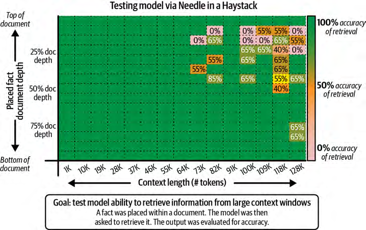

- **Review verdict: LOSSLESS**
- Reason: Needle-in-a-haystack heatmap with small cells, percentages, and annotations.
- Reviewed: 2026-10-14 (reviewer screening verdict from inspection of the 104 source images)

## Image 060 ? xref 1105

- Pages: 354
- Dimensions: 690x721
- Size as lossless PNG: 450,360 bytes ? as JPEG q90: 117,983 bytes
- OCR: **TEXT DETECTED** ? 32 item(s): 'Training' (h33px); 'Acoustic' (h20px); 'MuLan tokensM' (h22px); 'SemantictokensS' (h19px)
- Policy default: **UNCERTAIN ? lossless PNG** (OCR-positive); any reconsideration requires recorded rationale under a revised policy, never a silent override
- Full resolution: [Open image](full_p354_x1105.png)

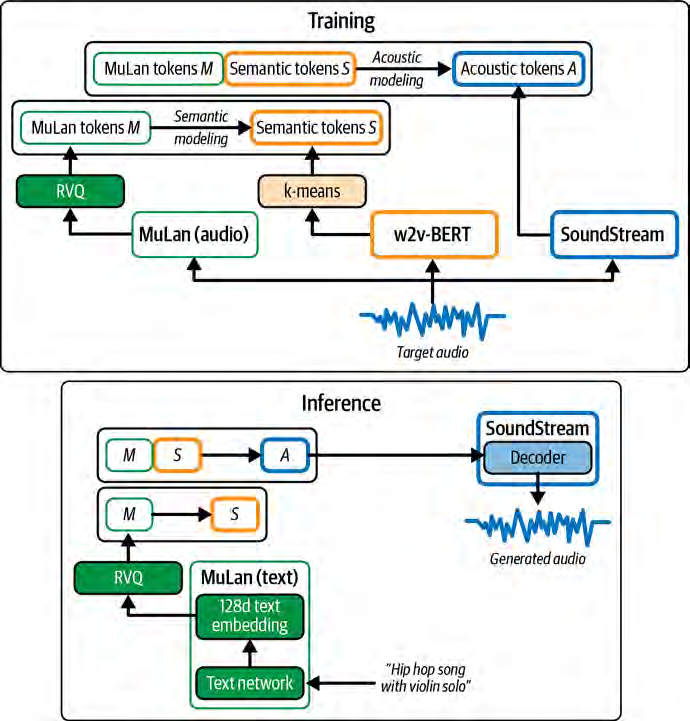

- **Review verdict: LOSSLESS**
- Reason: Training/inference architecture schematic with small labels and connected blocks.
- Reviewed: 2026-10-14 (reviewer screening verdict from inspection of the 104 source images)

## Image 061 ? xref 916

- Pages: 294
- Dimensions: 512x512
- Size as lossless PNG: 438,839 bytes ? as JPEG q90: 64,473 bytes
- OCR: **TEXT DETECTED** ? 1 item(s): 'RORLS' (h32px)
- Policy default: **UNCERTAIN ? lossless PNG** (OCR-positive); any reconsideration requires recorded rationale under a revised policy, never a silent override
- Full resolution: [Open image](full_p294_x916.png)

- **Review verdict: JPEG-ELIGIBLE**
- Reason: Genuine photographic portrait; facial details and grayscale tonal structure remain intact at q90. Documented, reviewer-approved reconsideration of the OCR-positive default.
- Reviewed: 2026-10-14 (reviewer screening verdict from inspection of the 104 source images)

## Image 062 ? xref 1207

- Pages: 386
- Dimensions: 448x420
- Size as lossless PNG: 432,905 bytes ? as JPEG q90: 76,215 bytes
- OCR: **TEXT DETECTED** ? 1 item(s): 'Apizzawithpepperoniandcheeseonaplate' (h17px)
- Policy default: **UNCERTAIN ? lossless PNG** (OCR-positive); any reconsideration requires recorded rationale under a revised policy, never a silent override
- Full resolution: [Open image](full_p386_x1207.png)

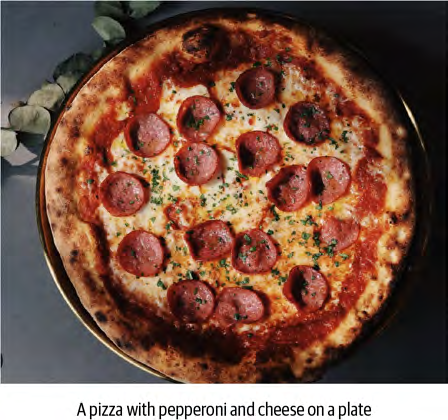

- **Review verdict: JPEG-ELIGIBLE**
- Reason: Food photograph; differences distributed through photographic texture, subject and caption legible. Documented, reviewer-approved reconsideration of the OCR-positive default.
- Reviewed: 2026-10-14 (reviewer screening verdict from inspection of the 104 source images)

## Image 063 ? xref 489

- Pages: 155
- Dimensions: 721x248
- Size as lossless PNG: 418,170 bytes ? as JPEG q90: 115,829 bytes
- OCR: **TEXT DETECTED** ? 3 item(s): 'Original' (h11px); 'Noisy（t=500,size=512)' (h12px); 'Noisy（t=500,size=64）' (h13px)
- Policy default: **UNCERTAIN ? lossless PNG** (OCR-positive); any reconsideration requires recorded rationale under a revised policy, never a silent override
- Full resolution: [Open image](full_p155_x489.png)

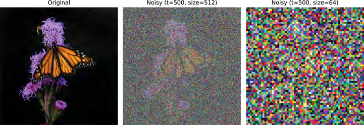

- **Review verdict: LOSSLESS**
- Reason: Flower photograph paired with heavily noisy image variants; mixed photographic and noise-pattern content.
- Reviewed: 2026-10-14 (reviewer screening verdict from inspection of the 104 source images)

## Image 064 ? xref 1118

- Pages: 358
- Dimensions: 567x415
- Size as lossless PNG: 402,626 bytes ? as JPEG q90: 85,308 bytes
- OCR: **TEXT DETECTED** ? 26 item(s): '+0dB' (h13px); '16384' (h15px); '-10dB' (h14px); '8192' (h14px)
- Policy default: **UNCERTAIN ? lossless PNG** (OCR-positive); any reconsideration requires recorded rationale under a revised policy, never a silent override
- Full resolution: [Open image](full_p358_x1118.png)

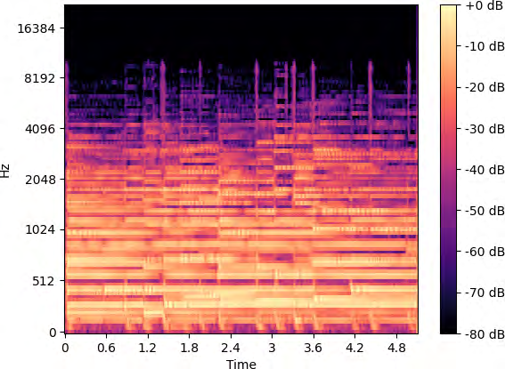

- **Review verdict: LOSSLESS**
- Reason: Spectrogram with fine horizontal frequency structure and scale labels.
- Reviewed: 2026-10-14 (reviewer screening verdict from inspection of the 104 source images)
