# REVIEW_4 ? OCR-flagged (uncertain/lossless by rule), continued

### xref 952 ? page 304 ? 710x457 ? 401,452 -> 86,746 bytes as q90 JPEG

**OCR: 25 text items** (e.g. 'Decoupled'; 'cross-attention'; '米'; '米') -> uncertain/lossless by the conservative rule; confirm

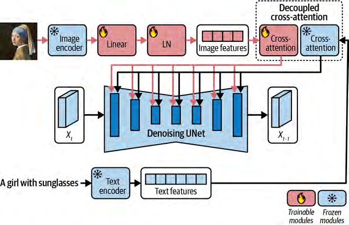

### xref 852 ? page 273 ? 600x300 ? 400,097 -> 55,610 bytes as q90 JPEG

**OCR: 1 text items** (e.g. 'O') -> uncertain/lossless by the conservative rule; confirm

### xref 568 ? page 179 ? 719x391 ? 386,522 -> 88,459 bytes as q90 JPEG

**OCR: 25 text items** (e.g. 'Pixelspace'; 'Latentspace'; 'Conditioning'; 'Diffusionprocess') -> uncertain/lossless by the conservative rule; confirm

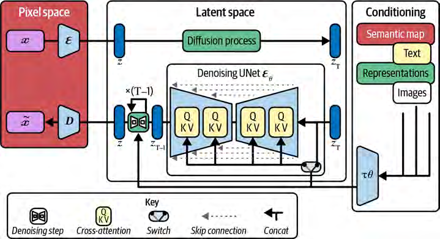

### xref 583 ? page 183 ? 613x729 ? 384,159 -> 95,846 bytes as q90 JPEG

**OCR: 16 text items** (e.g. 'Encoderhiddenstates'; '(akaoutput/textembeddings)'; 'Textmodel(stackoftransformerblocks)'; 'Transformerblock') -> uncertain/lossless by the conservative rule; confirm

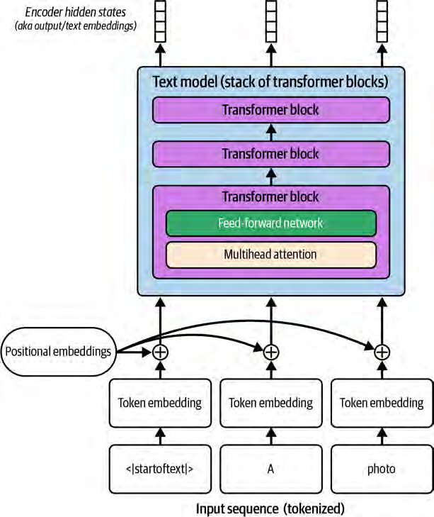

### xref 214 ? page 67 ? 595x534 ? 377,964 -> 70,991 bytes as q90 JPEG

**OCR: 20 text items** (e.g. 'Input'; 'Image-'; 'Output'; 'classification') -> uncertain/lossless by the conservative rule; confirm

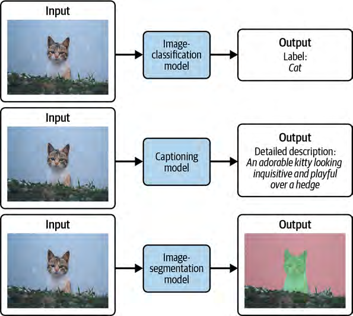

### xref 179 ? page 56 ? 411x793 ? 363,097 -> 84,141 bytes as q90 JPEG

**OCR: 32 text items** (e.g. 'Outputprobabilities'; 'Softmax'; 'Linear'; 'Add&norm') -> uncertain/lossless by the conservative rule; confirm

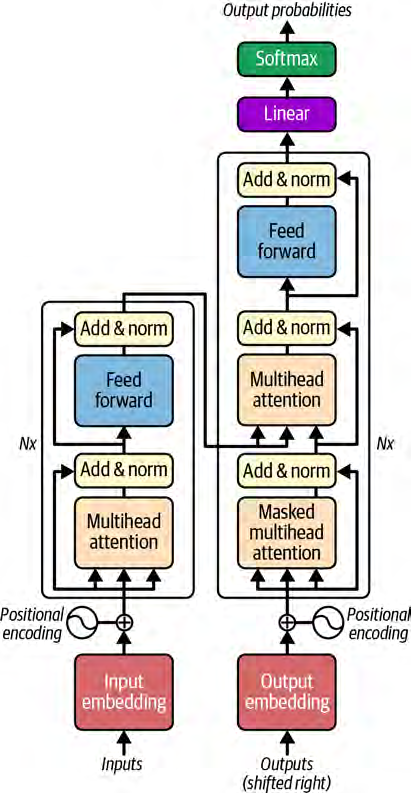

### xref 998 ? page 318 ? 719x309 ? 356,999 -> 65,371 bytes as q90 JPEG

**OCR: 9 text items** (e.g. 'Twinkle'; 'Twinkte'; 'Star'; 'Lit tle') -> uncertain/lossless by the conservative rule; confirm

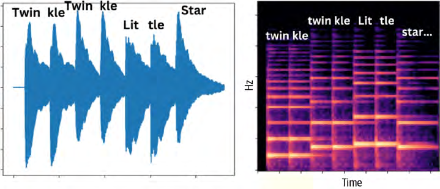

### xref 493 ? page 156 ? 721x190 ? 348,649 -> 94,199 bytes as q90 JPEG

**OCR: 4 text items** (e.g. 'Scale:1.0'; 'Scale:0.7'; 'Scale:0.4'; 'Scale:0.1') -> uncertain/lossless by the conservative rule; confirm

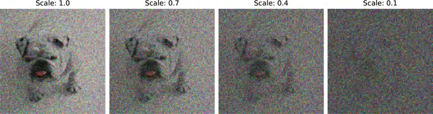

### xref 941 ? page 301 ? 720x240 ? 337,845 -> 54,185 bytes as q90 JPEG

**OCR: 1 text items** (e.g. '福') -> uncertain/lossless by the conservative rule; confirm

### xref 866 ? page 277 ? 720x271 ? 334,426 -> 51,089 bytes as q90 JPEG

**OCR: 3 text items** (e.g. 'Inputimage'; 'MiDaSdepth'; '"amecharobotswimming') -> uncertain/lossless by the conservative rule; confirm

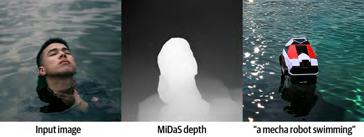

### xref 837 ? page 268 ? 721x381 ? 325,405 -> 74,316 bytes as q90 JPEG

**OCR: 18 text items** (e.g. 'Reconstructionloss'; '"A[V]dog"'; 'Super-resolutioncomponents:'; 'Fine-tuning+unconditional') -> uncertain/lossless by the conservative rule; confirm

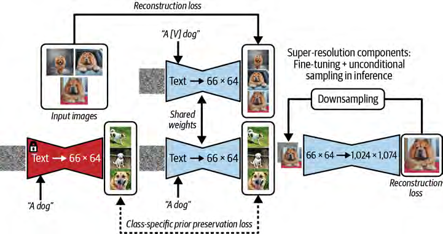

### xref 1008 ? page 321 ? 600x440 ? 319,879 -> 89,143 bytes as q90 JPEG

**OCR: 48 text items** (e.g. 'Sinewavewithfrequency1'; 'Sinewavewithfrequency2'; '1.0'; '1.0') -> uncertain/lossless by the conservative rule; confirm

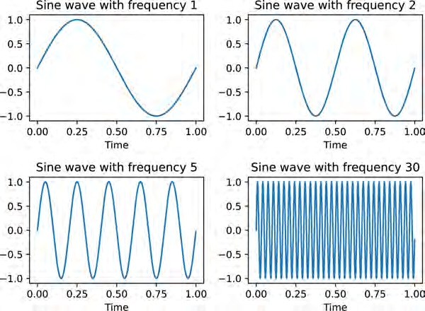

### xref 1044 ? page 333 ? 718x348 ? 313,882 -> 78,988 bytes as q90 JPEG

**OCR: 39 text items** (e.g. 'Multitasktrainingformat'; 'Special'; 'TextTimestamp'; 'tokens') -> uncertain/lossless by the conservative rule; confirm

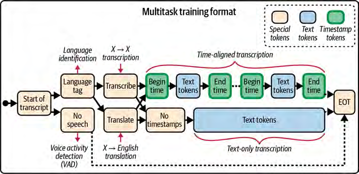

### xref 1082 ? page 347 ? 441x383 ? 312,092 -> 44,316 bytes as q90 JPEG

**OCR: 11 text items** (e.g. '10'; '20'; '30'; '40') -> uncertain/lossless by the conservative rule; confirm

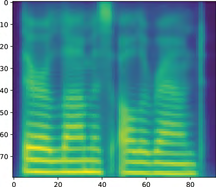

### xref 1192 ? page 382 ? 671x253 ? 311,462 -> 52,988 bytes as q90 JPEG

**OCR: 2 text items** (e.g. 'Originalphoto'; 'Depthmap') -> uncertain/lossless by the conservative rule; confirm

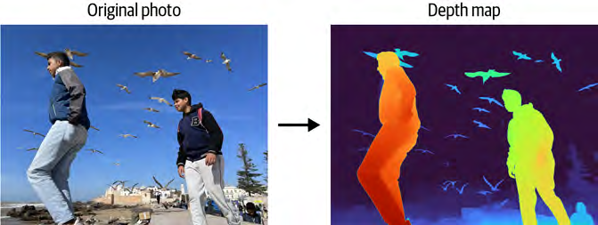

### xref 813 ? page 260 ? 716x354 ? 308,832 -> 62,918 bytes as q90 JPEG

**OCR: 21 text items** (e.g. 'Hubblesnapsimagesof'; 'anebulawithinacluster.'; 'Text'; 'Theuniqueplanetary') -> uncertain/lossless by the conservative rule; confirm

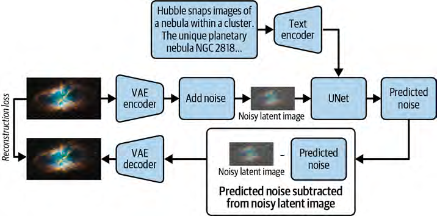

### xref 1211 ? page 387 ? 720x359 ? 308,300 -> 58,306 bytes as q90 JPEG

**OCR: 12 text items** (e.g. 'Molmo'; 'Multimodal OpenLanguageModel builtbyAi2'; 'LearnaboutMolmo'; 'What kind of music is this?') -> uncertain/lossless by the conservative rule; confirm

### xref 354 ? page 112 ? 600x597 ? 297,252 -> 91,399 bytes as q90 JPEG

**OCR: 2 text items** (e.g. '2'; '2') -> uncertain/lossless by the conservative rule; confirm

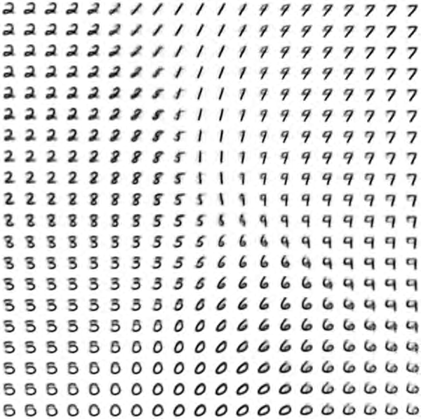

### xref 1170 ? page 375 ? 515x522 ? 283,302 -> 65,413 bytes as q90 JPEG

**OCR: 18 text items** (e.g. 'Traditional'; 'TransformerblockwithMoE'; 'transformerblock'; 'Output') -> uncertain/lossless by the conservative rule; confirm

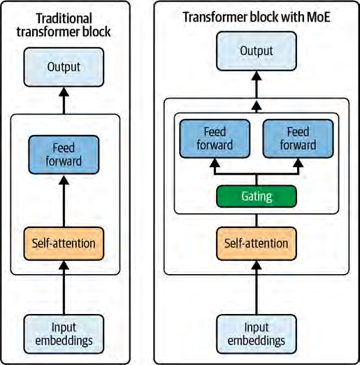

### xref 920 ? page 295 ? 720x192 ? 263,060 -> 50,220 bytes as q90 JPEG

**OCR: 8 text items** (e.g. 'Aphotoofa'; 'Aphotoofa'; 'Anorigamiofa'; 'Asketchofa') -> uncertain/lossless by the conservative rule; confirm

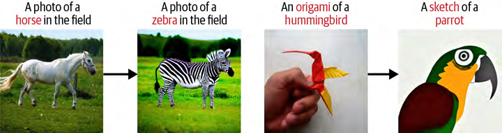

### xref 1012 ? page 322 ? 570x448 ? 259,249 -> 74,125 bytes as q90 JPEG

**OCR: 24 text items** (e.g. 'Waveform'; 'Spectrum'; '1000'; 'Frequency:1') -> uncertain/lossless by the conservative rule; confirm

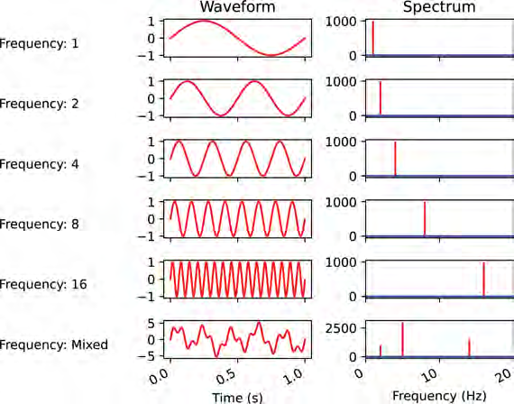

### xref 1200 ? page 384 ? 709x197 ? 257,018 -> 53,532 bytes as q90 JPEG

**OCR: 3 text items** (e.g. 'Prompt:Labradorsurfingwaves'; '十'; '1.') -> uncertain/lossless by the conservative rule; confirm

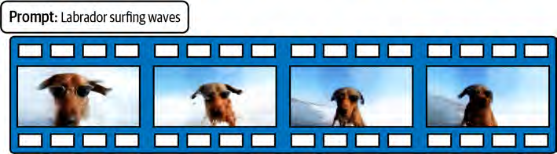

### xref 360 ? page 114 ? 545x331 ? 256,404 -> 54,934 bytes as q90 JPEG

**OCR: 24 text items** (e.g. 'Pepperthe'; 'Text'; 'Aussiepup'; 'encoder') -> uncertain/lossless by the conservative rule; confirm

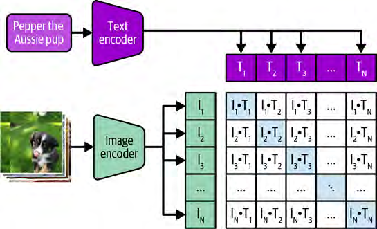

### xref 170 ? page 53 ? 490x629 ? 252,704 -> 59,093 bytes as q90 JPEG

**OCR: 12 text items** (e.g. 'Task-specificlayer'; 'Contextualizedembeddings:[[0.31..][0.12.'; 'nofthese'; 'Transformerblock') -> uncertain/lossless by the conservative rule; confirm

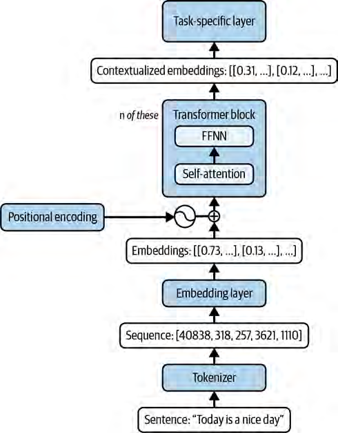

### xref 997 ? page 318 ? 721x392 ? 248,213 -> 60,389 bytes as q90 JPEG

**OCR: 17 text items** (e.g. '0.3'; '0.2'; '0.1'; '0.0') -> uncertain/lossless by the conservative rule; confirm

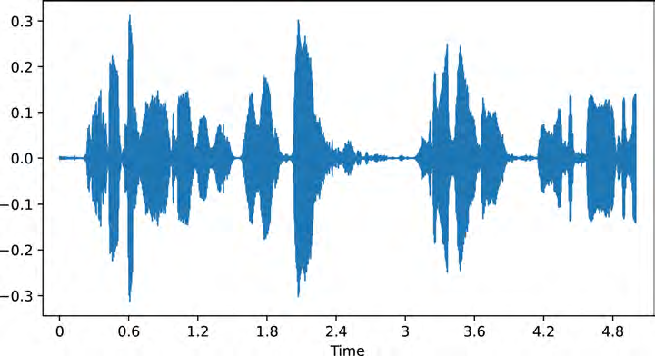

### xref 977 ? page 312 ? 596x284 ? 235,718 -> 58,205 bytes as q90 JPEG

**OCR: 23 text items** (e.g. 'Input'; 'Automatic'; 'Output'; 'WM') -> uncertain/lossless by the conservative rule; confirm

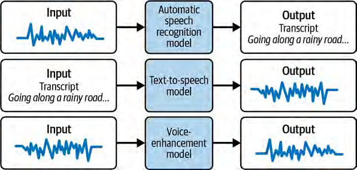

### xref 142 ? page 45 ? 683x484 ? 233,504 -> 56,182 bytes as q90 JPEG

**OCR: 8 text items** (e.g. 't=1'; 'TokenTToken2Token3 Token4'; 't=0'; 't=0.4') -> uncertain/lossless by the conservative rule; confirm

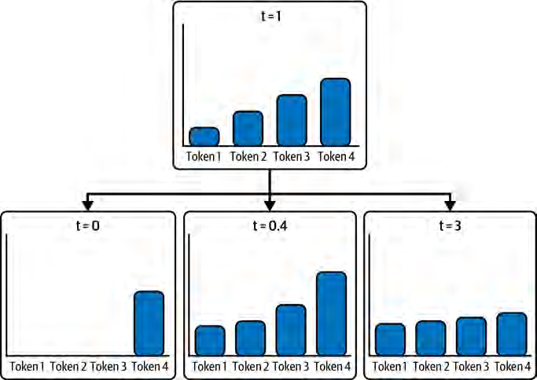

### xref 701 ? page 222 ? 536x526 ? 229,477 -> 43,950 bytes as q90 JPEG

**OCR: 26 text items** (e.g. 'Normalizedconfusionmatrix'; 'World-'; '0.92'; '0.02') -> uncertain/lossless by the conservative rule; confirm

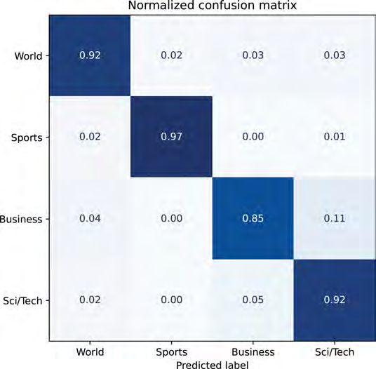

### xref 683 ? page 215 ? 545x353 ? 226,302 -> 53,513 bytes as q90 JPEG

**OCR: 16 text items** (e.g. 'Sports'; 'Output'; 'Linear'; 'H') -> uncertain/lossless by the conservative rule; confirm

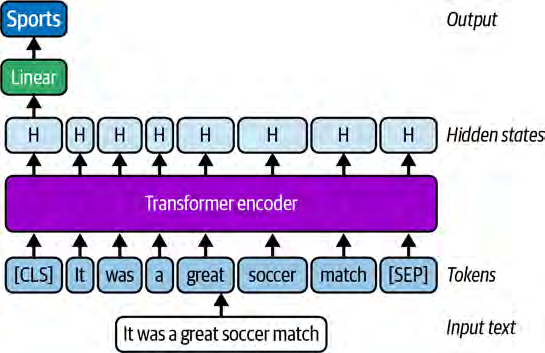

### xref 499 ? page 158 ? 717x433 ? 221,555 -> 62,242 bytes as q90 JPEG

**OCR: 20 text items** (e.g. 'Skipconnection'; 'Skipconnection'; 'd1'; '32') -> uncertain/lossless by the conservative rule; confirm

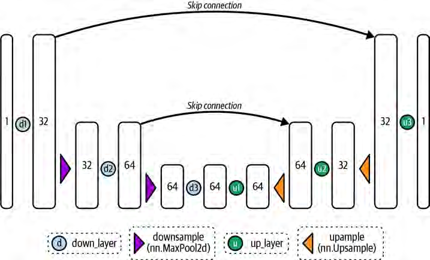

### xref 440 ? page 140 ? 717x433 ? 221,209 -> 62,235 bytes as q90 JPEG

**OCR: 20 text items** (e.g. 'Skipconnection'; 'Skipconnection'; 'd1'; '32') -> uncertain/lossless by the conservative rule; confirm

### xref 425 ? page 136 ? 649x176 ? 212,861 -> 43,455 bytes as q90 JPEG

**OCR: 4 text items** (e.g. 'Originalimage'; 'Rotated90degrees'; 'Verticalflip'; 'Translation') -> uncertain/lossless by the conservative rule; confirm

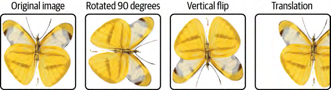

### xref 1076 ? page 345 ? 636x369 ? 210,254 -> 53,179 bytes as q90 JPEG

**OCR: 23 text items** (e.g. 'Speechdecoder'; 'Textdecoder'; 'post-net'; 'post-net') -> uncertain/lossless by the conservative rule; confirm

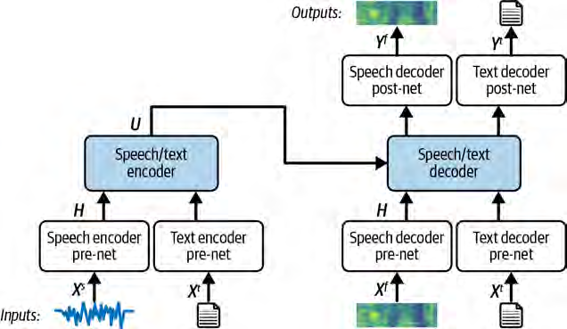

### xref 509 ? page 161 ? 721x283 ? 207,484 -> 62,058 bytes as q90 JPEG

**OCR: 41 text items** (e.g. '0.10'; 'Lossesovertime'; '0.0200'; 'Losses-detai') -> uncertain/lossless by the conservative rule; confirm

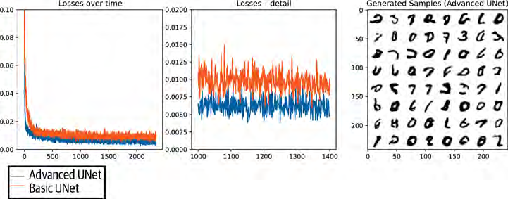

### xref 312 ? page 99 ? 531x231 ? 203,988 -> 35,212 bytes as q90 JPEG

**OCR: 8 text items** (e.g. 'Original'; 'Reconstructed'; 'VAE'; 'Encoder') -> uncertain/lossless by the conservative rule; confirm

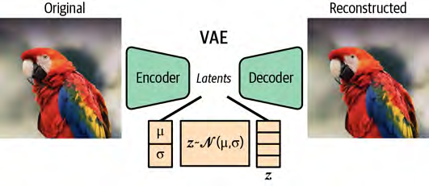

### xref 1101 ? page 353 ? 675x406 ? 202,099 -> 51,054 bytes as q90 JPEG

**OCR: 19 text items** (e.g. 'Predictedsemantic'; 'tokens'; 'Semantic'; 'modeling') -> uncertain/lossless by the conservative rule; confirm

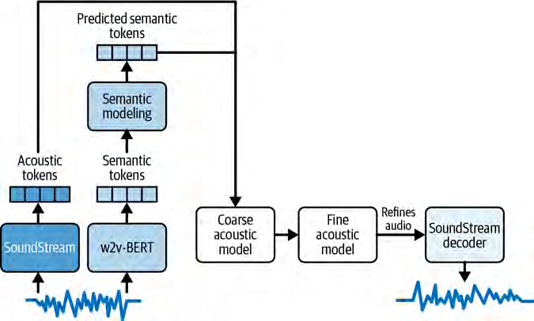

### xref 752 ? page 240 ? 510x289 ? 192,693 -> 42,086 bytes as q90 JPEG

**OCR: 14 text items** (e.g. 'Duringtraining'; 'Aftertraining'; '门'; '8') -> uncertain/lossless by the conservative rule; confirm

### xref 853 ? page 273 ? 510x289 ? 192,586 -> 42,012 bytes as q90 JPEG

**OCR: 14 text items** (e.g. 'Duringtraining'; 'Aftertraining'; 'h'; 'B') -> uncertain/lossless by the conservative rule; confirm

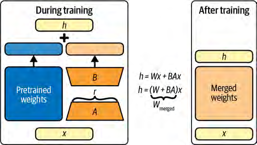

### xref 485 ? page 154 ? 646x403 ? 191,849 -> 57,316 bytes as q90 JPEG

**OCR: 16 text items** (e.g. '1.0'; 'defaultschedule'; 'cosineschedule'; '0.8') -> uncertain/lossless by the conservative rule; confirm

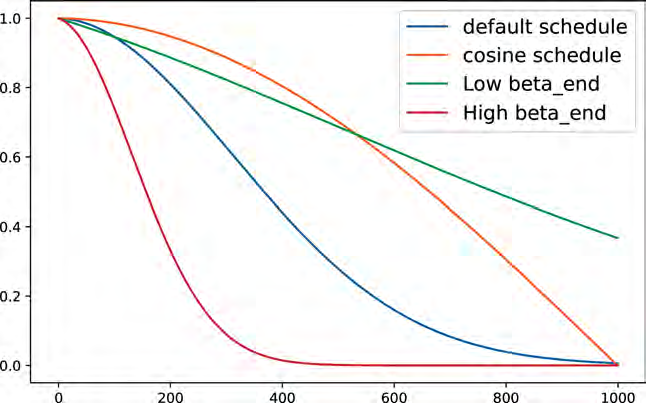

### xref 199 ? page 62 ? 504x338 ? 183,225 -> 45,966 bytes as q90 JPEG

**OCR: 18 text items** (e.g. '$$$incompute'; 'Base'; 'Pretrained'; 'model') -> uncertain/lossless by the conservative rule; confirm

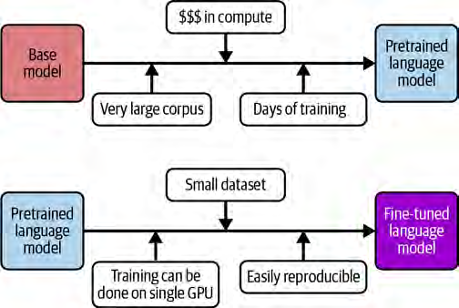

### xref 1005 ? page 320 ? 428x374 ? 172,371 -> 47,979 bytes as q90 JPEG

**OCR: 4 text items** (e.g. '>SSS'; 'Sinewave'; 'Violin'; 'Piano') -> uncertain/lossless by the conservative rule; confirm

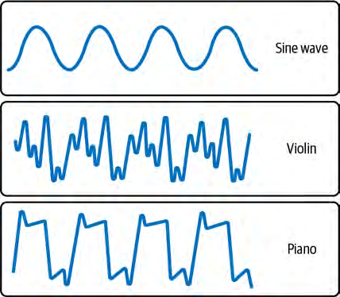

### xref 445 ? page 142 ? 720x297 ? 162,024 -> 44,879 bytes as q90 JPEG

**OCR: 4 text items** (e.g. 'Trainingloss'; 'Traininglossfromstep400'; 'Trainingstep'; 'Trainingstep') -> uncertain/lossless by the conservative rule; confirm

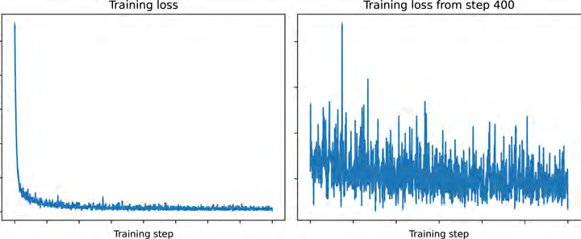

### xref 661 ? page 207 ? 277x395 ? 160,029 -> 36,366 bytes as q90 JPEG

**OCR: 7 text items** (e.g. '1.Identifydataset'; '2.Define model type'; '3.Selectbasemodel'; '4.Preprocessdataset') -> uncertain/lossless by the conservative rule; confirm

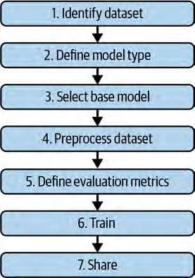

### xref 1091 ? page 350 ? 704x249 ? 158,916 -> 33,391 bytes as q90 JPEG

**OCR: 14 text items** (e.g. 'Semantic'; 'tokens'; 'Text'; 'Semantic') -> uncertain/lossless by the conservative rule; confirm

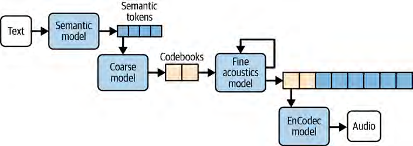

### xref 152 ? page 47 ? 641x244 ? 157,804 -> 38,114 bytes as q90 JPEG

**OCR: 3 text items** (e.g. 'top_k=5'; 'top_p=0.94'; 'Token1Token2Token3Token4Token5Token6Toke') -> uncertain/lossless by the conservative rule; confirm

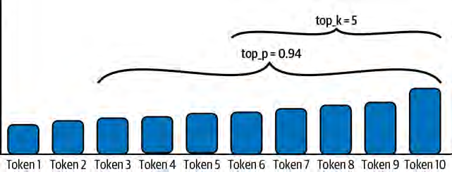

### xref 128 ? page 41 ? 391x421 ? 153,608 -> 38,186 bytes as q90 JPEG

**OCR: 25 text items** (e.g. 'barks'; '0.4'; 'bop'; '0.5') -> uncertain/lossless by the conservative rule; confirm

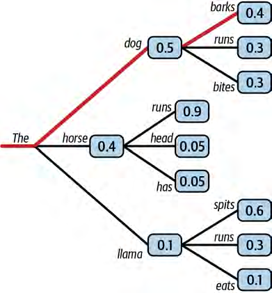

### xref 132 ? page 42 ? 391x421 ? 150,059 -> 37,612 bytes as q90 JPEG

**OCR: 25 text items** (e.g. 'barks'; '0.4'; 'bop'; '0.5') -> uncertain/lossless by the conservative rule; confirm

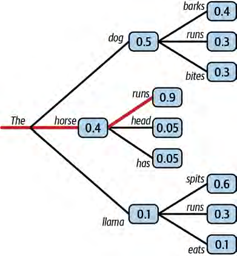

### xref 505 ? page 160 ? 720x318 ? 143,823 -> 40,015 bytes as q90 JPEG

**OCR: 3 text items** (e.g. '5798元05'; '17y?7'; '35777817') -> uncertain/lossless by the conservative rule; confirm

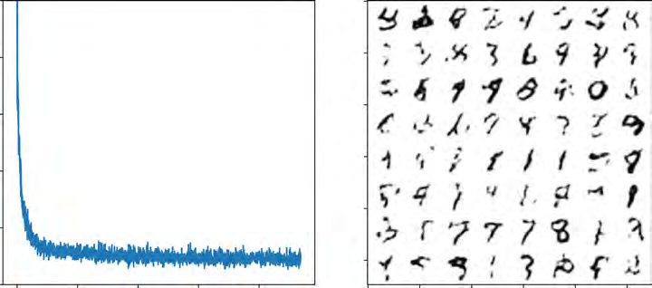

### xref 579 ? page 182 ? 496x223 ? 133,960 -> 28,337 bytes as q90 JPEG

**OCR: 8 text items** (e.g. 'Textembeddings'; '(77,1024)'; 'Noisylatents'; 'UNet') -> uncertain/lossless by the conservative rule; confirm

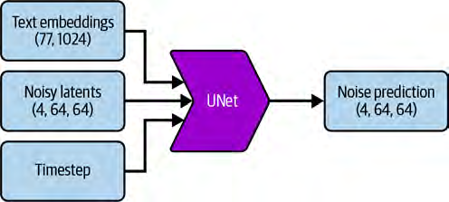

### xref 594 ? page 186 ? 720x173 ? 126,220 -> 34,274 bytes as q90 JPEG

**OCR: 4 text items** (e.g. 'Channel'; 'Channeli'; 'Channel2'; 'Channel3') -> uncertain/lossless by the conservative rule; confirm

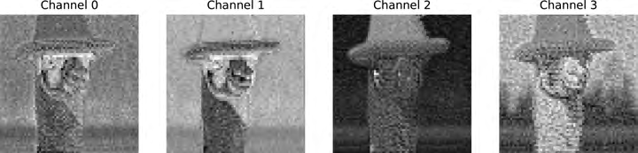

### xref 332 ? page 106 ? 532x392 ? 124,670 -> 35,545 bytes as q90 JPEG

**OCR: 15 text items** (e.g. 'loss'; '175'; 'reconstruction_loss'; 'kI_loss') -> uncertain/lossless by the conservative rule; confirm

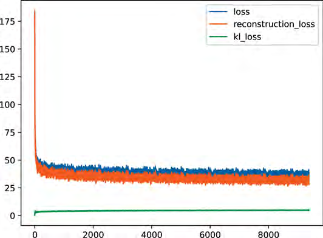

### xref 759 ? page 242 ? 406x321 ? 122,992 -> 27,086 bytes as q90 JPEG

**OCR: 16 text items** (e.g. 'Sign'; 'Range'; 'Precision'; 'FP32') -> uncertain/lossless by the conservative rule; confirm

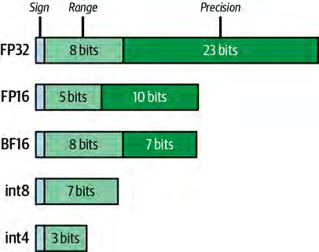

### xref 333 ? page 106 ? 720x300 ? 121,373 -> 34,931 bytes as q90 JPEG

**OCR: 6 text items** (e.g. 'VAE-KLLossComponent'; 'VAE-ReconstructionLossComponent'; 'LoSS'; 'S507') -> uncertain/lossless by the conservative rule; confirm

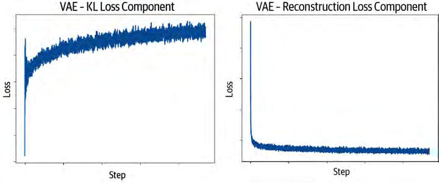

### xref 247 ? page 77 ? 514x190 ? 116,976 -> 27,065 bytes as q90 JPEG

**OCR: 10 text items** (e.g. 'Input'; 'Encoder'; 'Latent'; 'Decoder') -> uncertain/lossless by the conservative rule; confirm

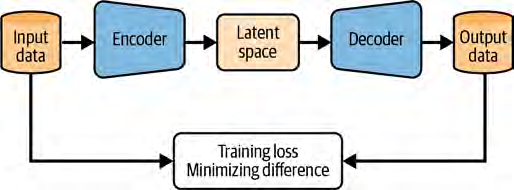

### xref 482 ? page 153 ? 526x388 ? 116,584 -> 35,259 bytes as q90 JPEG

**OCR: 13 text items** (e.g. '1.0'; '0.8'; '0.6'; 'Vaequivalent') -> uncertain/lossless by the conservative rule; confirm

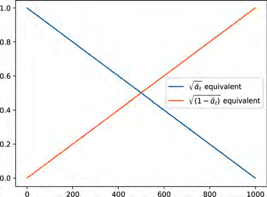

### xref 479 ? page 152 ? 526x388 ? 114,826 -> 34,296 bytes as q90 JPEG

**OCR: 13 text items** (e.g. '1.0'; '0.8'; '0.6'; 'at') -> uncertain/lossless by the conservative rule; confirm

### xref 1363 ? page 254,398 ? 370x306 ? 111,204 -> 25,698 bytes as q90 JPEG

**OCR: 7 text items** (e.g. 'Externalmemory'; 'Query'; 'Retriever'; 'Contextrelevant') -> uncertain/lossless by the conservative rule; confirm

### xref 110 ? page 35 ? 721x68 ? 110,404 -> 27,862 bytes as q90 JPEG

**OCR: 1 text items** (e.g. '1012121131012511814190182114149147010121') -> uncertain/lossless by the conservative rule; confirm

### xref 293 ? page 93 ? 556x433 ? 105,649 -> 31,329 bytes as q90 JPEG

**OCR: 14 text items** (e.g. 'TrainingLossCurve(twolatentdimensions)'; '0.30'; '0.25'; '0.20') -> uncertain/lossless by the conservative rule; confirm

### xref 1020 ? page 324 ? 721x382 ? 104,852 -> 35,309 bytes as q90 JPEG

**OCR: 22 text items** (e.g. '175'; 'Domain'; '150'; 'Frequency') -> uncertain/lossless by the conservative rule; confirm

### xref 589 ? page 185 ? 646x101 ? 103,238 -> 22,375 bytes as q90 JPEG

**OCR: 10 text items** (e.g. 'Inputimage'; 'VAE'; 'Latents'; 'VAE') -> uncertain/lossless by the conservative rule; confirm

### xref 189 ? page 59 ? 620x140 ? 101,446 -> 22,536 bytes as q90 JPEG

**OCR: 8 text items** (e.g. 'Mask'; 'A[MASK]wasbarkinga lot'; 'Transformer'; 'Embedding') -> uncertain/lossless by the conservative rule; confirm

### xref 343 ? page 109 ? 721x140 ? 99,875 -> 15,362 bytes as q90 JPEG

**OCR: 18 text items** (e.g. '3'; 'b'; '3'; '7') -> uncertain/lossless by the conservative rule; confirm

### xref 641 ? page 200 ? 722x287 ? 99,322 -> 27,228 bytes as q90 JPEG

**OCR: 6 text items** (e.g. 'name'; 'output'; 'Pedro'; 'HelloPedro') -> uncertain/lossless by the conservative rule; confirm

### xref 989 ? page 316 ? 440x226 ? 99,108 -> 27,398 bytes as q90 JPEG

**OCR: 11 text items** (e.g. 'mm'; '0'; '0.1'; '0.2') -> uncertain/lossless by the conservative rule; confirm

### xref 764 ? page 244 ? 716x219 ? 83,384 -> 24,594 bytes as q90 JPEG

**OCR: 8 text items** (e.g. '12GB'; '16GB'; '200GB'; 'GPU') -> uncertain/lossless by the conservative rule; confirm

### xref 288 ? page 91 ? 509x387 ? 82,084 -> 24,269 bytes as q90 JPEG

**OCR: 3 text items** (e.g. 'ReLU'; 'Sigmoid'; '3') -> uncertain/lossless by the conservative rule; confirm

### xref 115 ? page 36 ? 606x68 ? 80,785 -> 18,859 bytes as q90 JPEG

**OCR: 18 text items** (e.g. 'lla'; 'ma'; 'learn'; 'S') -> uncertain/lossless by the conservative rule; confirm

### xref 1152 ? page 370 ? 392x144 ? 79,578 -> 15,985 bytes as q90 JPEG

**OCR: 3 text items** (e.g. 'Humanfeedback'; 'Fine-tuning'; 'Pretraining') -> uncertain/lossless by the conservative rule; confirm

### xref 279 ? page 88 ? 543x430 ? 78,688 -> 26,381 bytes as q90 JPEG

**OCR: 13 text items** (e.g. 'AutoEncoder-TrainingLossCurve'; '0.5'; '0.4'; '0.3') -> uncertain/lossless by the conservative rule; confirm

### xref 138 ? page 44 ? 209x373 ? 72,961 -> 19,643 bytes as q90 JPEG

**OCR: 12 text items** (e.g. '60%'; '35%'; '5%'; 'apple') -> uncertain/lossless by the conservative rule; confirm

### xref 558 ? page 176 ? 541x390 ? 70,091 -> 22,662 bytes as q90 JPEG

**OCR: 12 text items** (e.g. '1.0'; '0.8'; '0.6'; '0.4') -> uncertain/lossless by the conservative rule; confirm

### xref 1016 ? page 323 ? 720x163 ? 69,614 -> 26,562 bytes as q90 JPEG

**OCR: 12 text items** (e.g. '5.0'; '2.5'; 'W'; '0.0') -> uncertain/lossless by the conservative rule; confirm

### xref 111 ? page 35 ? 491x68 ? 65,965 -> 15,989 bytes as q90 JPEG

**OCR: 14 text items** (e.g. 'a'; 'llama'; 'learns'; 'running') -> uncertain/lossless by the conservative rule; confirm

### xref 453 ? page 144 ? 380x100 ? 65,309 -> 15,165 bytes as q90 JPEG

**OCR: 5 text items** (e.g. 'Image'; '(3,299,299)'; 'CNN'; 'Feature') -> uncertain/lossless by the conservative rule; confirm

### xref 993 ? page 317 ? 708x125 ? 64,264 -> 18,356 bytes as q90 JPEG

**OCR: 4 text items** (e.g. 'OdB'; '10dB'; '120dB'; '310dB') -> uncertain/lossless by the conservative rule; confirm

### xref 296 ? page 94 ? 720x84 ? 45,882 -> 13,813 bytes as q90 JPEG

**OCR: 21 text items** (e.g. '7'; '4'; '6'; 'D') -> uncertain/lossless by the conservative rule; confirm

### xref 337 ? page 107 ? 720x84 ? 45,040 -> 13,932 bytes as q90 JPEG

**OCR: 19 text items** (e.g. '7'; '2'; 'h'; '6') -> uncertain/lossless by the conservative rule; confirm

### xref 282 ? page 89 ? 720x84 ? 42,838 -> 14,493 bytes as q90 JPEG

**OCR: 18 text items** (e.g. '7'; '2'; '4'; '4a59') -> uncertain/lossless by the conservative rule; confirm

### xref 542 ? page 171 ? 300x188 ? 42,419 -> 11,089 bytes as q90 JPEG

**OCR: 4 text items** (e.g. '0'; '2'; '7'; '2') -> uncertain/lossless by the conservative rule; confirm

### xref 350 ? page 111 ? 720x62 ? 33,427 -> 7,445 bytes as q90 JPEG

**OCR: 9 text items** (e.g. '2'; '2'; '2'; '8') -> uncertain/lossless by the conservative rule; confirm

### xref 305 ? page 97 ? 720x53 ? 28,099 -> 8,001 bytes as q90 JPEG

**OCR: 7 text items** (e.g. 'AutoEncoder'; 'o'; '/'; '1') -> uncertain/lossless by the conservative rule; confirm

### xref 1341 ? page 17,261 ? 104x99 ? 17,853 -> 6,119 bytes as q90 JPEG

**OCR: 1 text items** (e.g. 'T') -> uncertain/lossless by the conservative rule; confirm

