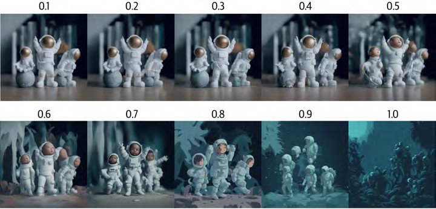
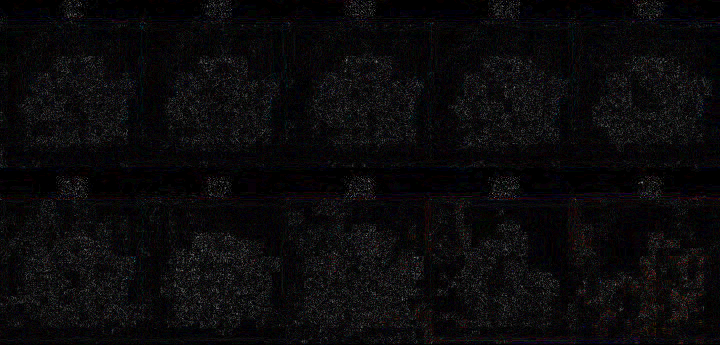
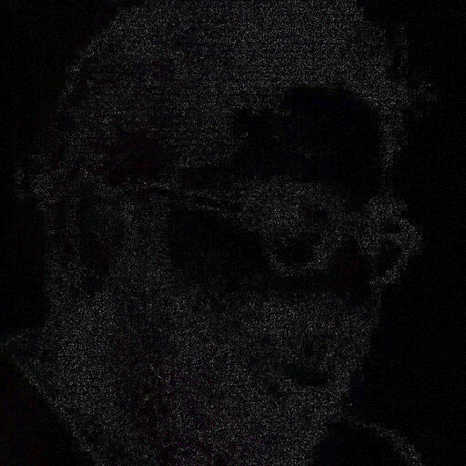
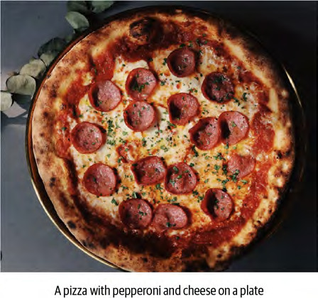
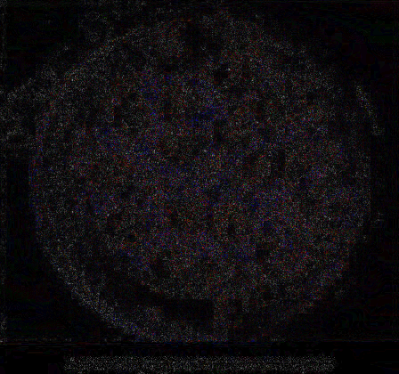
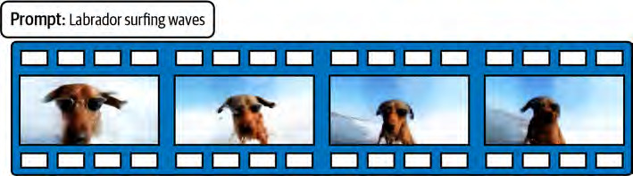
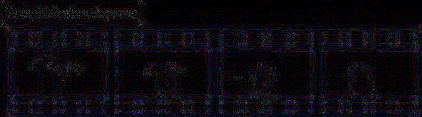

# Phase 2 comparison batches ? Images 037?147

Generated at fixed quality 90 from the original PNG sources; originals untouched. Difference maps are |PNG ? JPEG| ? 8, clipped (black = no loss). Verdicts remain the reviewer's after native-resolution inspection; production encoding is unauthorized.

## Batch 1 ? Images 048, 061, 062, 086 (verdicts PENDING)

### Image 048 ? xref 888 ? 720x345

- Screening reason: Astronaut image sequence; check whether labels or fine details affect the decision
- PNG: 524,462 bytes ? JPEG q90: 73,333 bytes ? **86.0% saved**
- Fidelity metrics: max abs diff 17/255 ? mean 1.3 ? 0.4% of pixels differ by more than 8/255
- [JPEG q90 test copy](img048_x888.jpeg) ? [Amplified difference map](img048_x888_diff8x.png)

- **Review verdict: PENDING** ? assign after native-resolution inspection of the pair

### Image 061 ? xref 916 ? 512x512

- Screening reason: Black-and-white portrait photograph; a plausible photographic candidate
- PNG: 438,839 bytes ? JPEG q90: 64,473 bytes ? **85.3% saved**
- Fidelity metrics: max abs diff 17/255 ? mean 1.43 ? 0.7% of pixels differ by more than 8/255
- [JPEG q90 test copy](img061_x916.jpeg) ? [Amplified difference map](img061_x916_diff8x.png)

- **Review verdict: PENDING** ? assign after native-resolution inspection of the pair

### Image 062 ? xref 1207 ? 448x420

- Screening reason: Pizza photograph; a plausible photographic candidate
- PNG: 432,905 bytes ? JPEG q90: 76,215 bytes ? **82.4% saved**
- Fidelity metrics: max abs diff 24/255 ? mean 1.91 ? 3.8% of pixels differ by more than 8/255
- [JPEG q90 test copy](img062_x1207.jpeg) ? [Amplified difference map](img062_x1207_diff8x.png)

- **Review verdict: PENDING** ? assign after native-resolution inspection of the pair

### Image 086 ? xref 1200 ? 709x197

- Screening reason: Dog photograph sequence; check photographic detail and any meaningful frame labels
- PNG: 257,018 bytes ? JPEG q90: 53,532 bytes ? **79.2% saved**
- Fidelity metrics: max abs diff 31/255 ? mean 1.45 ? 2.5% of pixels differ by more than 8/255
- [JPEG q90 test copy](img086_x1200.jpeg) ? [Amplified difference map](img086_x1200_diff8x.png)

- **Review verdict: PENDING** ? assign after native-resolution inspection of the pair
