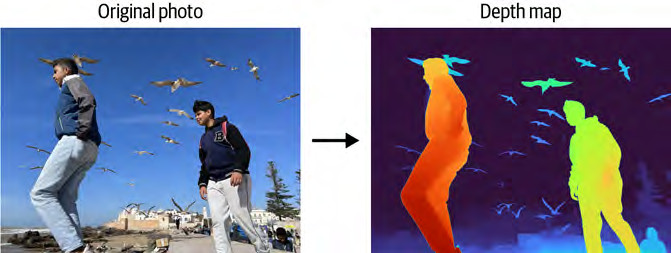
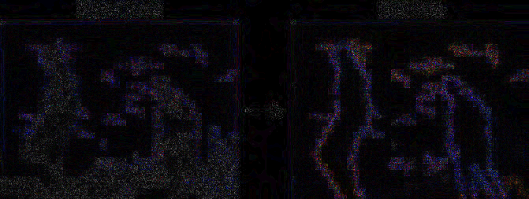
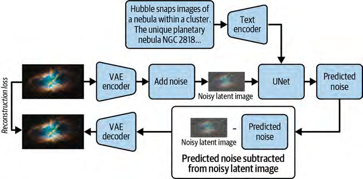
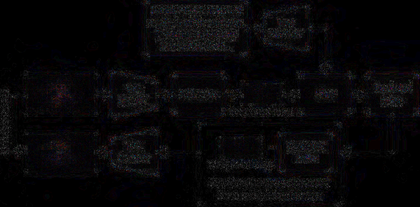
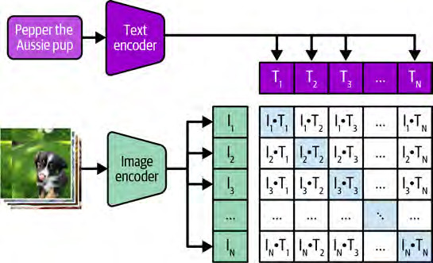
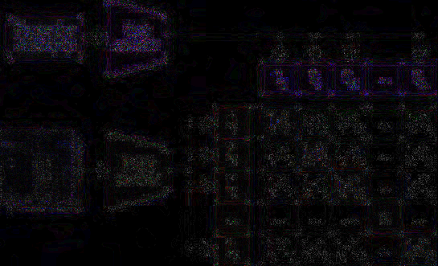

# Phase 2 comparison batches ? Images 037?147 (verdicts recorded 2026-10-14)

Generated at fixed quality 90 from the original PNG sources; originals untouched. Difference maps are |PNG ? JPEG| ? 8, clipped. Production encoding is unauthorized; JPEG-ELIGIBLE verdicts on OCR-positive images are documented, reviewer-approved reconsiderations of the policy default ? recorded with rationale, never silent.

### Image 048 ? xref 888 ? verdict: JPEG-ELIGIBLE

- Reason: Photographic astronaut sequence; the comparison shows no material loss of the sequence's visible numeric labels or meaningful detail at q90 (mean 1.30/255, 0.4% of pixels >8/255). Recorded as a documented, reviewer-approved reconsideration of the OCR-positive default.
- PNG: 524,462 bytes ? JPEG q90: 73,333 bytes ? 86.0% saved
- Fidelity metrics: max abs diff 17/255 ? mean 1.3 ? 0.4% of pixels differ by more than 8/255
- [JPEG q90 test copy](img048_x888.jpeg) ? [Amplified difference map](img048_x888_diff8x.png)

- **Review verdict: JPEG-ELIGIBLE** ? reviewed 2026-10-14 (reviewer verdict from inspection of the published PNG/JPEG/difference-map ZIP)

### Image 061 ? xref 916 ? verdict: JPEG-ELIGIBLE

- Reason: Genuine photographic portrait; hair, beard, glasses and grayscale tonal structure remain visually intact at q90 (mean 1.43/255, 0.7% >8/255). Documented reconsideration of the OCR-positive default.
- PNG: 438,839 bytes ? JPEG q90: 64,473 bytes ? 85.3% saved
- Fidelity metrics: max abs diff 17/255 ? mean 1.43 ? 0.7% of pixels differ by more than 8/255
- [JPEG q90 test copy](img061_x916.jpeg) ? [Amplified difference map](img061_x916_diff8x.png)

- **Review verdict: JPEG-ELIGIBLE** ? reviewed 2026-10-14 (reviewer verdict from inspection of the published PNG/JPEG/difference-map ZIP)

### Image 062 ? xref 1207 ? verdict: JPEG-ELIGIBLE

- Reason: Food photograph; differences are distributed through photographic texture and the subject and caption remain legible (mean 1.91/255, 3.8% >8/255, max 24/255 ? noted, not disqualifying). Documented reconsideration of the OCR-positive default.
- PNG: 432,905 bytes ? JPEG q90: 76,215 bytes ? 82.4% saved
- Fidelity metrics: max abs diff 24/255 ? mean 1.91 ? 3.8% of pixels differ by more than 8/255
- [JPEG q90 test copy](img062_x1207.jpeg) ? [Amplified difference map](img062_x1207_diff8x.png)

- **Review verdict: JPEG-ELIGIBLE** ? reviewed 2026-10-14 (reviewer verdict from inspection of the published PNG/JPEG/difference-map ZIP)

### Image 086 ? xref 1200 ? verdict: LOSSLESS

- Reason: Filmstrip-style sequence with thin rectangular borders and an embedded prompt label ? mixed photographic and diagram-like content; lossless retained rather than trading structural fidelity (max 31/255 along structural edges and text).
- PNG: 257,018 bytes ? JPEG q90: 53,532 bytes ? 79.2% saved (saving NOT banked: verdict is LOSSLESS)
- Fidelity metrics: max abs diff 31/255 ? mean 1.45 ? 2.5% of pixels differ by more than 8/255
- [JPEG q90 test copy](img086_x1200.jpeg) ? [Amplified difference map](img086_x1200_diff8x.png)

- **Review verdict: LOSSLESS** ? reviewed 2026-10-14 (reviewer verdict from inspection of the published PNG/JPEG/difference-map ZIP)

### Image 079 ? xref 1192 ? verdict: LOSSLESS

- Reason: Combines a photograph with a color-coded depth map, arrows and labels; the depth-map boundaries carry meaning and must not be exposed to lossy artifacts (max 34/255 reinforces caution; content type is the primary reason).
- PNG: 311,462 bytes ? JPEG q90: 52,988 bytes ? 83.0% saved (saving NOT banked: verdict is LOSSLESS)
- Fidelity metrics: max abs diff 34/255 ? mean 1.4 ? 3.7% of pixels differ by more than 8/255
- [JPEG q90 test copy](img079_x1192.jpeg) ? [Amplified difference map](img079_x1192_diff8x.png)

- **Review verdict: LOSSLESS** ? reviewed 2026-10-14 (reviewer verdict from inspection of the published PNG/JPEG/difference-map ZIP)

### Image 080 ? xref 813 ? verdict: LOSSLESS

- Reason: Process diagram with small text, arrows, boxes and embedded images ? not photographic; compression artifacts around text and thin lines are avoidable.
- PNG: 308,832 bytes ? JPEG q90: 62,918 bytes ? 79.6% saved (saving NOT banked: verdict is LOSSLESS)
- Fidelity metrics: max abs diff 25/255 ? mean 0.96 ? 1.1% of pixels differ by more than 8/255
- [JPEG q90 test copy](img080_x813.jpeg) ? [Amplified difference map](img080_x813_diff8x.png)

- **Review verdict: LOSSLESS** ? reviewed 2026-10-14 (reviewer verdict from inspection of the published PNG/JPEG/difference-map ZIP)

### Image 087 ? xref 360 ? verdict: LOSSLESS

- Reason: Technical diagram with labels, arrows, a token matrix and a small dog photograph; the photographic inset does not make the whole image JPEG-suitable ? preserve the complete diagram losslessly.
- PNG: 256,404 bytes ? JPEG q90: 54,934 bytes ? 78.6% saved (saving NOT banked: verdict is LOSSLESS)
- Fidelity metrics: max abs diff 34/255 ? mean 1.2 ? 2.5% of pixels differ by more than 8/255
- [JPEG q90 test copy](img087_x360.jpeg) ? [Amplified difference map](img087_x360_diff8x.png)

- **Review verdict: LOSSLESS** ? reviewed 2026-10-14 (reviewer verdict from inspection of the published PNG/JPEG/difference-map ZIP)
