# M3b comparison evidence ? JPEG q90 test copies (verdicts recorded)

Generated at fixed quality 90 from the original PNG sources; originals untouched. Difference maps are |PNG ? JPEG| ? 8, clipped (black = no loss). Verdicts are provisional visual approvals recorded 2026-10-14; they are not guarantees of native-resolution perceptual equivalence, and production encoding remains unauthorized.

**Approved by review: 18 of 19 candidates** (Image 013 xref 631 is UNCERTAIN and stays lossless). The 86.7% candidate-set figure assumed all 19 and is superseded by the recorded-verdicts projection in REVIEW.md.

---

# Proposed JPEG candidates

## Image 001 ? xref 926 ? test verdict: JPEG-ELIGIBLE

- Review reason: Portrait detail appears preserved at the reviewed scale.
- PNG: 1,171,895 bytes ? JPEG q90: 130,085 bytes ? 88.9% saved
- [JPEG q90 test copy](img001_x926.jpeg) ? [Amplified difference map](img001_x926_diff8x.png)

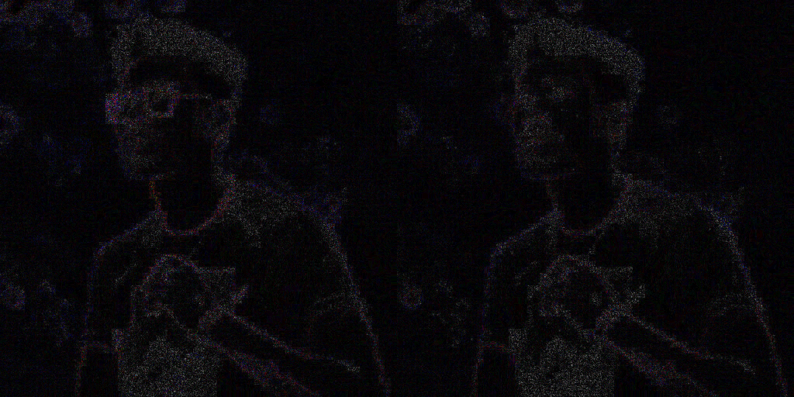

- **Test verdict: JPEG-ELIGIBLE** ? reviewed 2026-10-14 (provisional test verdict from the published q90 comparison inspection)

## Image 005 ? xref 956 ? test verdict: JPEG-ELIGIBLE

- Review reason: Photographic still life; no obvious material degradation.
- PNG: 663,252 bytes ? JPEG q90: 86,079 bytes ? 87.0% saved
- [JPEG q90 test copy](img005_x956.jpeg) ? [Amplified difference map](img005_x956_diff8x.png)

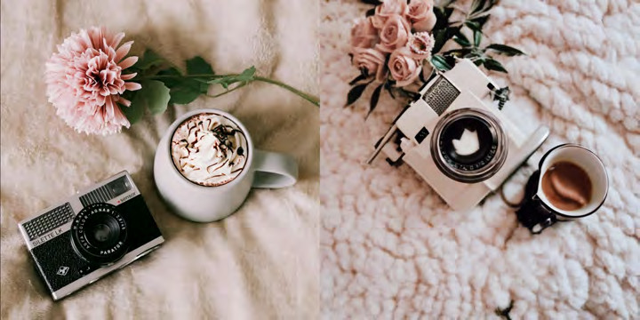

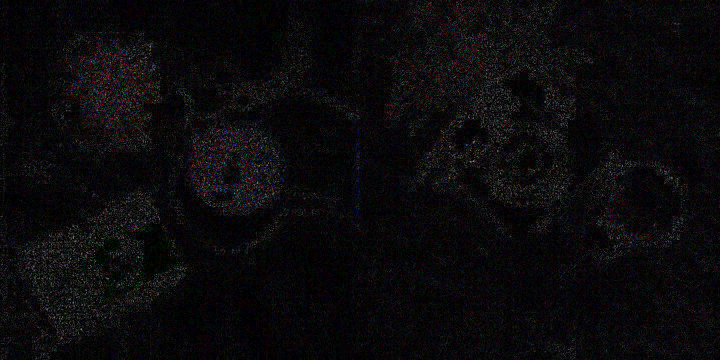

- **Test verdict: JPEG-ELIGIBLE** ? reviewed 2026-10-14 (provisional test verdict from the published q90 comparison inspection)

## Image 006 ? xref 834 ? test verdict: JPEG-ELIGIBLE

- Review reason: Star flare, stars, and broad gradients appear intact at the reviewed scale.
- PNG: 650,176 bytes ? JPEG q90: 67,172 bytes ? 89.7% saved
- [JPEG q90 test copy](img006_x834.jpeg) ? [Amplified difference map](img006_x834_diff8x.png)

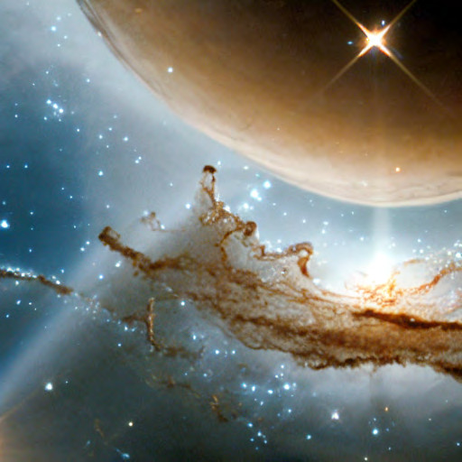

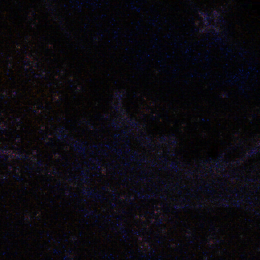

- **Test verdict: JPEG-ELIGIBLE** ? reviewed 2026-10-14 (provisional test verdict from the published q90 comparison inspection)

## Image 007 ? xref 87 ? test verdict: JPEG-ELIGIBLE

- Review reason: Photograph; no obvious material degradation.
- PNG: 620,644 bytes ? JPEG q90: 75,141 bytes ? 87.9% saved
- [JPEG q90 test copy](img007_x87.jpeg) ? [Amplified difference map](img007_x87_diff8x.png)

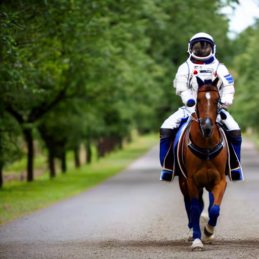

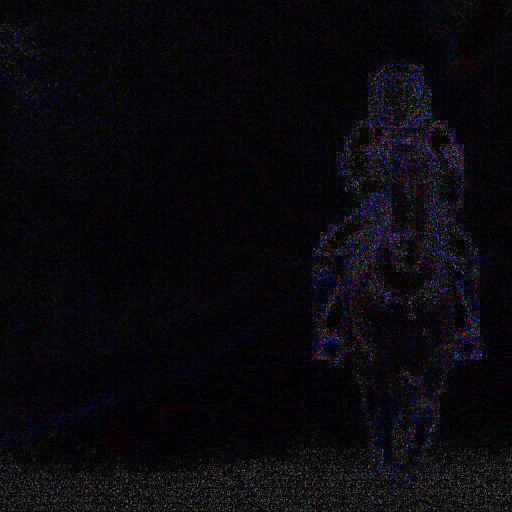

- **Test verdict: JPEG-ELIGIBLE** ? reviewed 2026-10-14 (provisional test verdict from the published q90 comparison inspection)

## Image 008 ? xref 934 ? test verdict: JPEG-ELIGIBLE

- Review reason: Landscape gradients and mountain edges appear acceptable.
- PNG: 524,836 bytes ? JPEG q90: 85,876 bytes ? 83.6% saved
- [JPEG q90 test copy](img008_x934.jpeg) ? [Amplified difference map](img008_x934_diff8x.png)

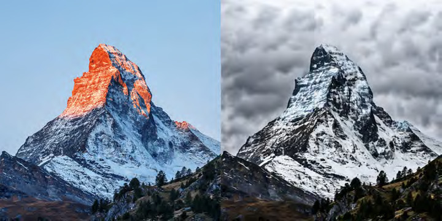

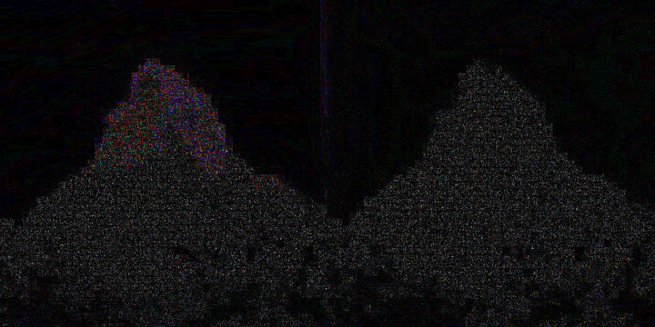

- **Test verdict: JPEG-ELIGIBLE** ? reviewed 2026-10-14 (provisional test verdict from the published q90 comparison inspection)

## Image 013 ? xref 631 ? test verdict: UNCERTAIN

- Review reason: Painterly texture is important; retain PNG pending closer native-resolution inspection.
- PNG: 453,184 bytes ? JPEG q90: 84,056 bytes ? 81.5% saved
- Saving NOT banked: UNCERTAIN means the image stays lossless regardless of size
- [JPEG q90 test copy](img013_x631.jpeg) ? [Amplified difference map](img013_x631_diff8x.png)

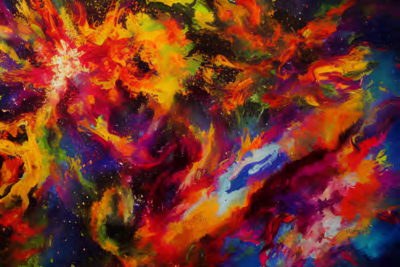

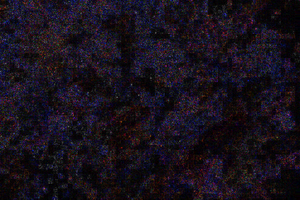

- **Test verdict: UNCERTAIN** ? reviewed 2026-10-14 (provisional test verdict from the published q90 comparison inspection)

## Image 014 ? xref 913 ? test verdict: JPEG-ELIGIBLE

- Review reason: Grayscale portrait detail appears acceptable.
- PNG: 443,807 bytes ? JPEG q90: 64,036 bytes ? 85.6% saved
- [JPEG q90 test copy](img014_x913.jpeg) ? [Amplified difference map](img014_x913_diff8x.png)

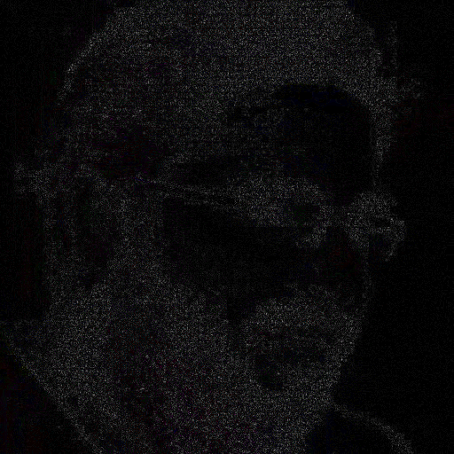

- **Test verdict: JPEG-ELIGIBLE** ? reviewed 2026-10-14 (provisional test verdict from the published q90 comparison inspection)

## Image 015 ? xref 910 ? test verdict: JPEG-ELIGIBLE

- Review reason: Grayscale portrait detail appears acceptable.
- PNG: 440,653 bytes ? JPEG q90: 63,102 bytes ? 85.7% saved
- [JPEG q90 test copy](img015_x910.jpeg) ? [Amplified difference map](img015_x910_diff8x.png)

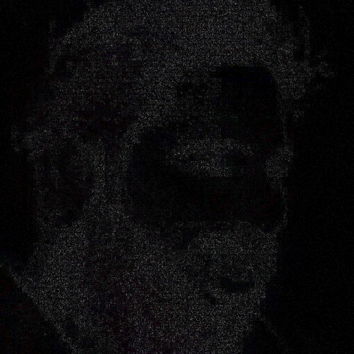

- **Test verdict: JPEG-ELIGIBLE** ? reviewed 2026-10-14 (provisional test verdict from the published q90 comparison inspection)

## Image 016 ? xref 907 ? test verdict: JPEG-ELIGIBLE

- Review reason: Grayscale portrait detail appears acceptable.
- PNG: 437,141 bytes ? JPEG q90: 63,498 bytes ? 85.5% saved
- [JPEG q90 test copy](img016_x907.jpeg) ? [Amplified difference map](img016_x907_diff8x.png)

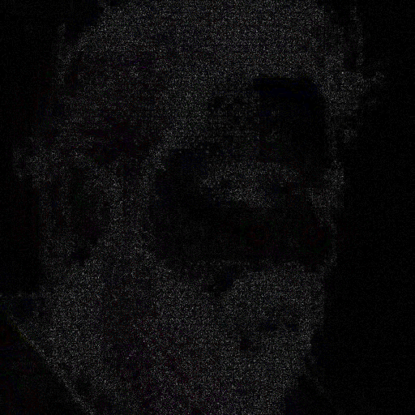

- **Test verdict: JPEG-ELIGIBLE** ? reviewed 2026-10-14 (provisional test verdict from the published q90 comparison inspection)

## Image 018 ? xref 367 ? test verdict: JPEG-ELIGIBLE

- Review reason: Wildlife photograph; no obvious material degradation.
- PNG: 422,294 bytes ? JPEG q90: 58,309 bytes ? 86.2% saved
- [JPEG q90 test copy](img018_x367.jpeg) ? [Amplified difference map](img018_x367_diff8x.png)

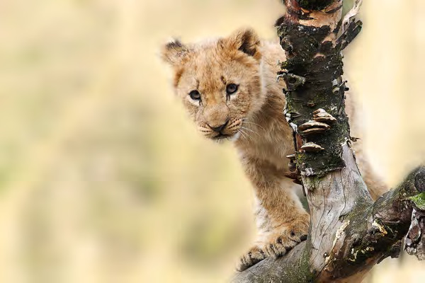

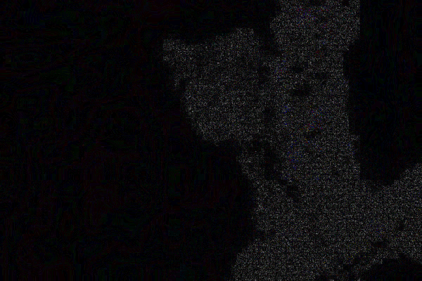

- **Test verdict: JPEG-ELIGIBLE** ? reviewed 2026-10-14 (provisional test verdict from the published q90 comparison inspection)

## Image 019 ? xref 903 ? test verdict: JPEG-ELIGIBLE

- Review reason: Mixed photographic/realistic collage; no obvious material degradation at the reviewed scale.
- PNG: 405,187 bytes ? JPEG q90: 57,726 bytes ? 85.8% saved
- [JPEG q90 test copy](img019_x903.jpeg) ? [Amplified difference map](img019_x903_diff8x.png)

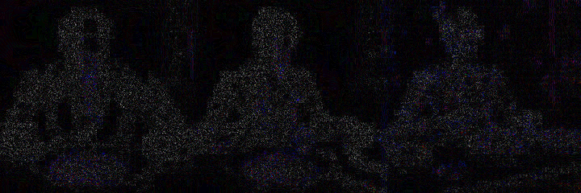

- **Test verdict: JPEG-ELIGIBLE** ? reviewed 2026-10-14 (provisional test verdict from the published q90 comparison inspection)

## Image 020 ? xref 611 ? test verdict: JPEG-ELIGIBLE

- Review reason: Cat photograph; no obvious material degradation.
- PNG: 385,953 bytes ? JPEG q90: 44,363 bytes ? 88.5% saved
- [JPEG q90 test copy](img020_x611.jpeg) ? [Amplified difference map](img020_x611_diff8x.png)

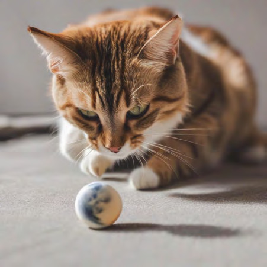

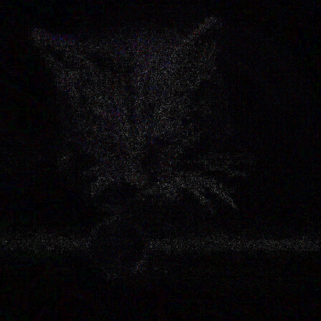

- **Test verdict: JPEG-ELIGIBLE** ? reviewed 2026-10-14 (provisional test verdict from the published q90 comparison inspection)

## Image 021 ? xref 373 ? test verdict: JPEG-ELIGIBLE

- Review reason: Wildlife photograph; no obvious material degradation.
- PNG: 384,255 bytes ? JPEG q90: 57,522 bytes ? 85.0% saved
- [JPEG q90 test copy](img021_x373.jpeg) ? [Amplified difference map](img021_x373_diff8x.png)

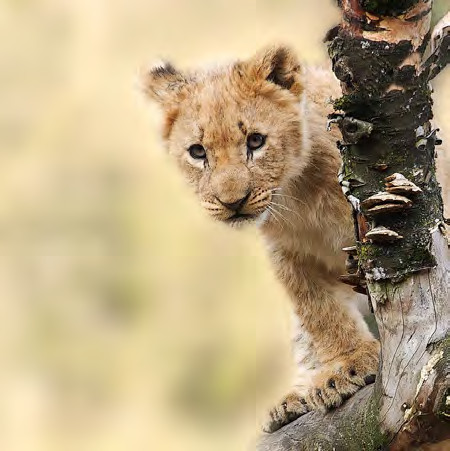

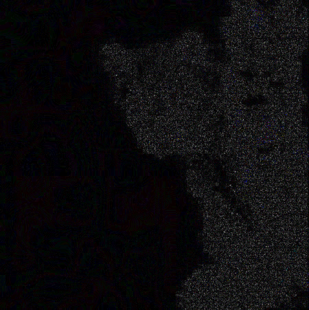

- **Test verdict: JPEG-ELIGIBLE** ? reviewed 2026-10-14 (provisional test verdict from the published q90 comparison inspection)

## Image 022 ? xref 218 ? test verdict: JPEG-ELIGIBLE

- Review reason: Cat photograph; no obvious material degradation.
- PNG: 352,753 bytes ? JPEG q90: 42,784 bytes ? 87.9% saved
- [JPEG q90 test copy](img022_x218.jpeg) ? [Amplified difference map](img022_x218_diff8x.png)

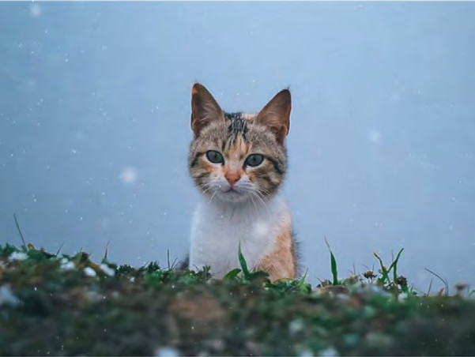

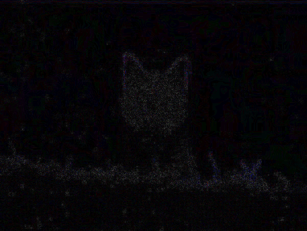

- **Test verdict: JPEG-ELIGIBLE** ? reviewed 2026-10-14 (provisional test verdict from the published q90 comparison inspection)

## Image 023 ? xref 618 ? test verdict: JPEG-ELIGIBLE

- Review reason: Photographic strip; no obvious material degradation at the reviewed scale.
- PNG: 346,518 bytes ? JPEG q90: 49,238 bytes ? 85.8% saved
- [JPEG q90 test copy](img023_x618.jpeg) ? [Amplified difference map](img023_x618_diff8x.png)

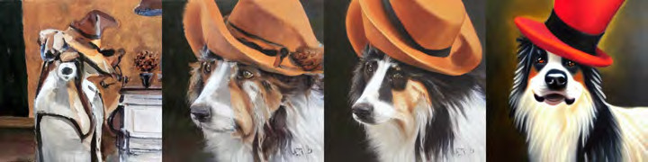

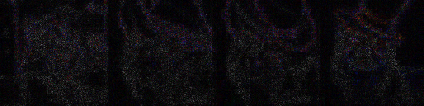

- **Test verdict: JPEG-ELIGIBLE** ? reviewed 2026-10-14 (provisional test verdict from the published q90 comparison inspection)

## Image 028 ? xref 848 ? test verdict: JPEG-ELIGIBLE

- Review reason: Portrait strip; no obvious material degradation.
- PNG: 281,784 bytes ? JPEG q90: 44,970 bytes ? 84.0% saved
- [JPEG q90 test copy](img028_x848.jpeg) ? [Amplified difference map](img028_x848_diff8x.png)

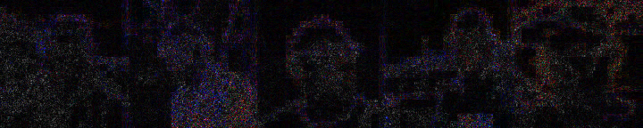

- **Test verdict: JPEG-ELIGIBLE** ? reviewed 2026-10-14 (provisional test verdict from the published q90 comparison inspection)

## Image 029 ? xref 598 ? test verdict: JPEG-ELIGIBLE

- Review reason: Wildlife photograph; no obvious material degradation.
- PNG: 269,502 bytes ? JPEG q90: 32,035 bytes ? 88.1% saved
- [JPEG q90 test copy](img029_x598.jpeg) ? [Amplified difference map](img029_x598_diff8x.png)

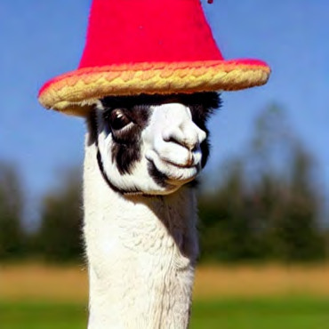

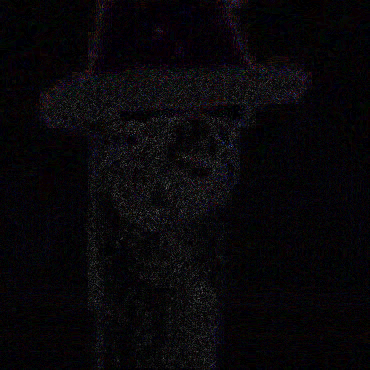

- **Test verdict: JPEG-ELIGIBLE** ? reviewed 2026-10-14 (provisional test verdict from the published q90 comparison inspection)

## Image 030 ? xref 590 ? test verdict: JPEG-ELIGIBLE

- Review reason: Wildlife photograph; no obvious material degradation.
- PNG: 264,507 bytes ? JPEG q90: 31,411 bytes ? 88.1% saved
- [JPEG q90 test copy](img030_x590.jpeg) ? [Amplified difference map](img030_x590_diff8x.png)

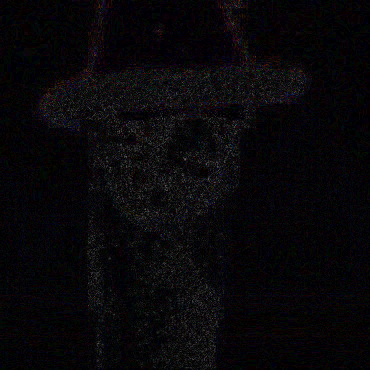

- **Test verdict: JPEG-ELIGIBLE** ? reviewed 2026-10-14 (provisional test verdict from the published q90 comparison inspection)

## Image 033 ? xref 416 ? test verdict: JPEG-ELIGIBLE

- Review reason: Portrait photograph; no obvious material degradation.
- PNG: 154,716 bytes ? JPEG q90: 15,803 bytes ? 89.8% saved
- [JPEG q90 test copy](img033_x416.jpeg) ? [Amplified difference map](img033_x416_diff8x.png)

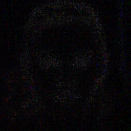

- **Test verdict: JPEG-ELIGIBLE** ? reviewed 2026-10-14 (provisional test verdict from the published q90 comparison inspection)

---

# Lossless validations (confirmed LOSSLESS)

## Image 002 ? xref 467 ? test verdict: LOSSLESS

- Review reason: Butterfly markings and noise-pattern panels are content that compression may alter.
- PNG: 972,598 bytes ? JPEG q90: 233,017 bytes ? 76.0% saved
- Saving NOT banked: LOSSLESS means the image stays lossless regardless of size
- [JPEG q90 test copy](img002_x467.jpeg) ? [Amplified difference map](img002_x467_diff8x.png)

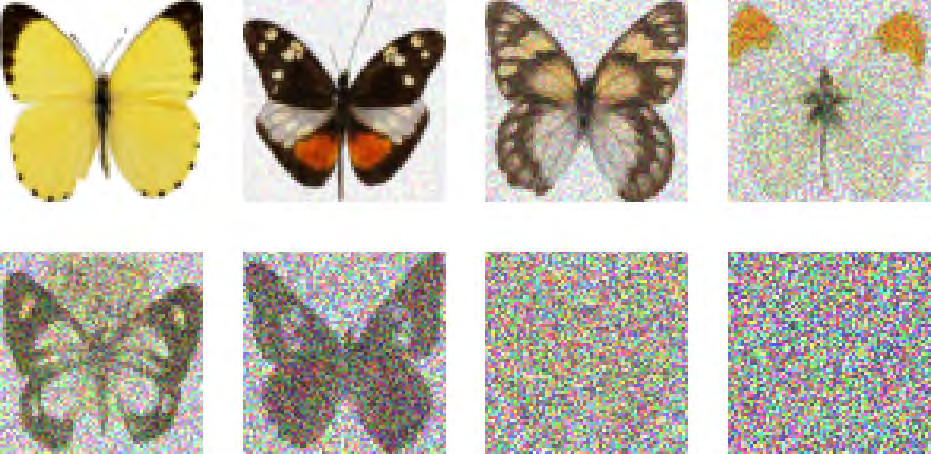

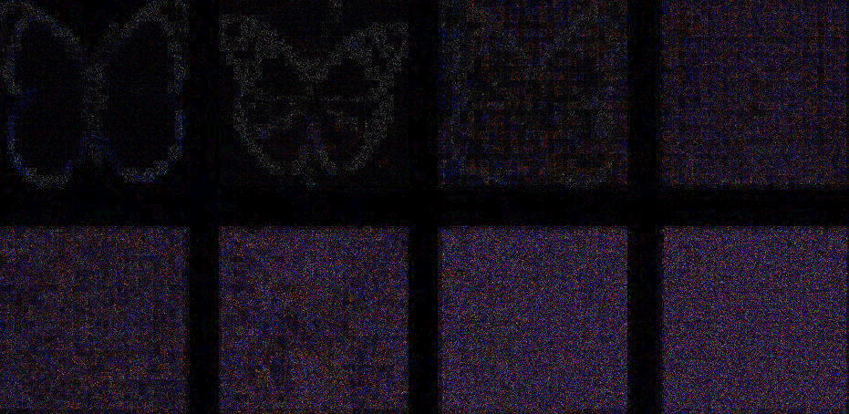

- **Test verdict: LOSSLESS** ? reviewed 2026-10-14 (provisional test verdict from the published q90 comparison inspection)

## Image 003 ? xref 470 ? test verdict: LOSSLESS

- Review reason: Fine markings and noise patterns should remain unchanged.
- PNG: 972,305 bytes ? JPEG q90: 233,118 bytes ? 76.0% saved
- Saving NOT banked: LOSSLESS means the image stays lossless regardless of size
- [JPEG q90 test copy](img003_x470.jpeg) ? [Amplified difference map](img003_x470_diff8x.png)

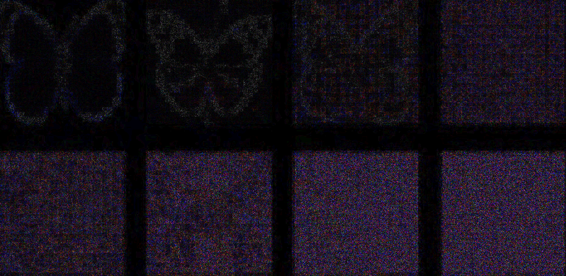

- **Test verdict: LOSSLESS** ? reviewed 2026-10-14 (provisional test verdict from the published q90 comparison inspection)

## Image 004 ? xref 473 ? test verdict: LOSSLESS

- Review reason: High-frequency patterns and fine detail warrant preservation.
- PNG: 922,798 bytes ? JPEG q90: 260,076 bytes ? 71.8% saved
- Saving NOT banked: LOSSLESS means the image stays lossless regardless of size
- [JPEG q90 test copy](img004_x473.jpeg) ? [Amplified difference map](img004_x473_diff8x.png)

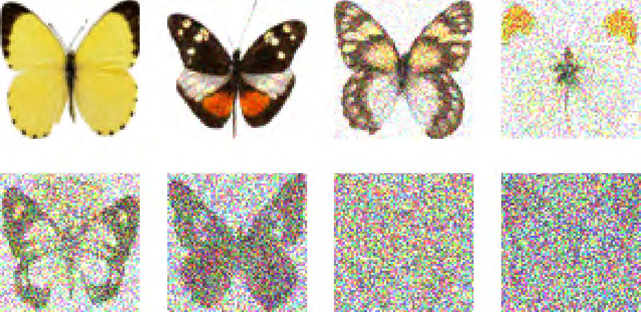

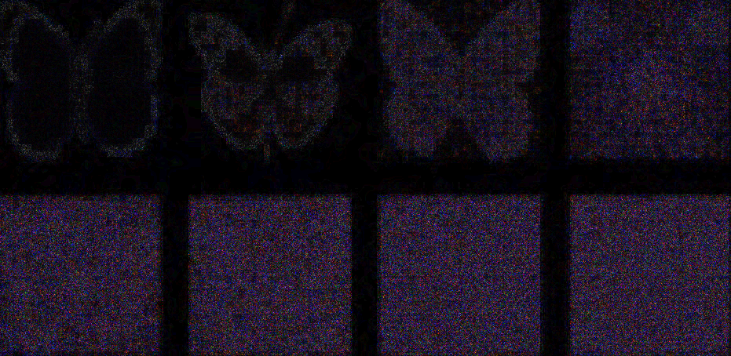

- **Test verdict: LOSSLESS** ? reviewed 2026-10-14 (provisional test verdict from the published q90 comparison inspection)

## Image 010 ? xref 436 ? test verdict: LOSSLESS

- Review reason: Comparison grid and degraded/noise panels should remain faithful to the source.
- PNG: 500,551 bytes ? JPEG q90: 96,319 bytes ? 80.8% saved
- Saving NOT banked: LOSSLESS means the image stays lossless regardless of size
- [JPEG q90 test copy](img010_x436.jpeg) ? [Amplified difference map](img010_x436_diff8x.png)

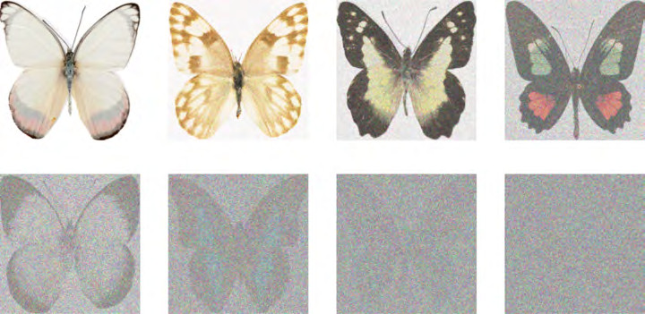

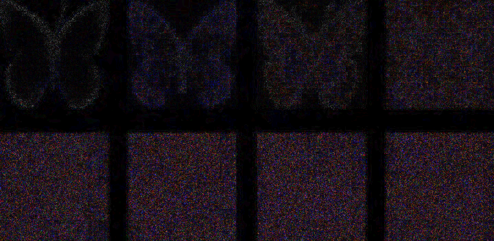

- **Test verdict: LOSSLESS** ? reviewed 2026-10-14 (provisional test verdict from the published q90 comparison inspection)

## Image 011 ? xref 452 ? test verdict: LOSSLESS

- Review reason: Preserve butterfly-wing detail.
- PNG: 486,959 bytes ? JPEG q90: 69,869 bytes ? 85.7% saved
- Saving NOT banked: LOSSLESS means the image stays lossless regardless of size
- [JPEG q90 test copy](img011_x452.jpeg) ? [Amplified difference map](img011_x452_diff8x.png)

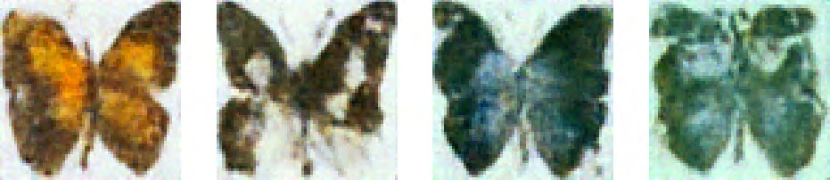

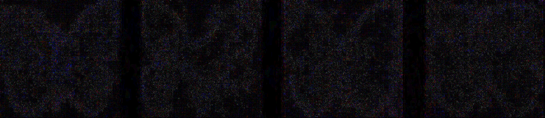

- **Test verdict: LOSSLESS** ? reviewed 2026-10-14 (provisional test verdict from the published q90 comparison inspection)

## Image 012 ? xref 448 ? test verdict: LOSSLESS

- Review reason: Preserve butterfly-wing detail.
- PNG: 464,215 bytes ? JPEG q90: 62,360 bytes ? 86.6% saved
- Saving NOT banked: LOSSLESS means the image stays lossless regardless of size
- [JPEG q90 test copy](img012_x448.jpeg) ? [Amplified difference map](img012_x448_diff8x.png)

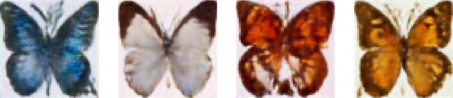

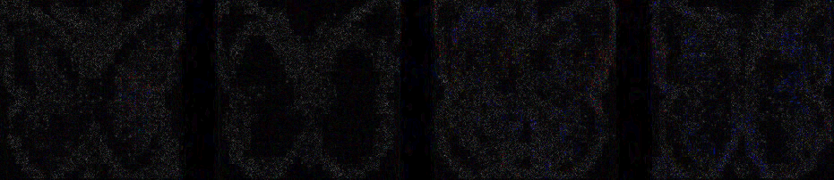

- **Test verdict: LOSSLESS** ? reviewed 2026-10-14 (provisional test verdict from the published q90 comparison inspection)

## Image 027 ? xref 412 ? test verdict: LOSSLESS

- Review reason: Preserve the noise-pattern sequence and small embedded imagery.
- PNG: 281,861 bytes ? JPEG q90: 85,430 bytes ? 69.7% saved
- Saving NOT banked: LOSSLESS means the image stays lossless regardless of size
- [JPEG q90 test copy](img027_x412.jpeg) ? [Amplified difference map](img027_x412_diff8x.png)

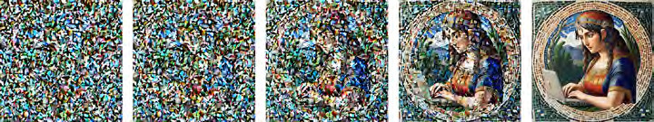

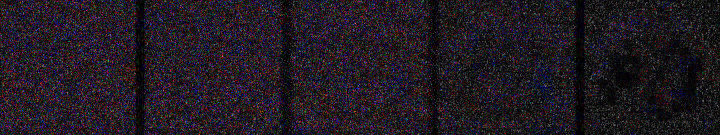

- **Test verdict: LOSSLESS** ? reviewed 2026-10-14 (provisional test verdict from the published q90 comparison inspection)
